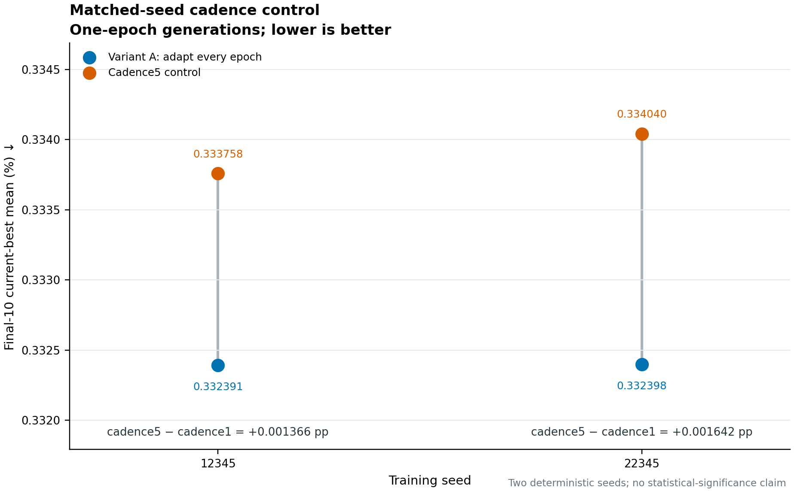
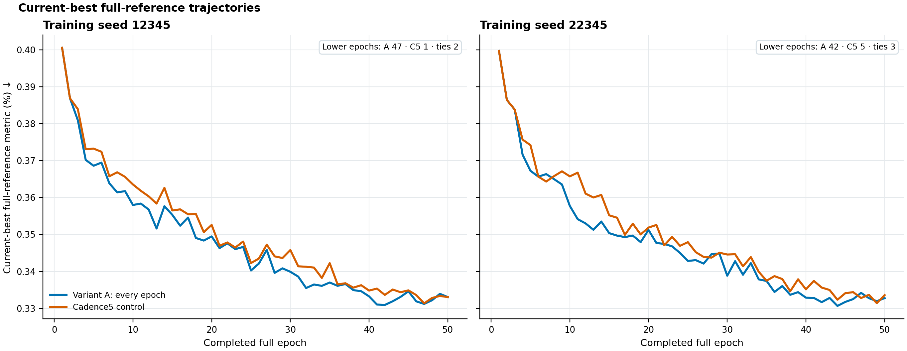

Archived Reports
================

Reports kept unchanged as historical records. They use the internal labels and the
interpretation current at the time they were written; the mapping to present
terminology is in :doc:`../history`, and the current interpretation is in
:doc:`../results`.

* :download:`PBT interim technical status (2026-10-01) <PBT_INTERIM_TECHNICAL_STATUS.md>`:
  every-epoch PBT versus the every-five-epochs control on two seeds, and the
  sub-epoch adaptation blocker. It predates the independent holdout evaluation,
  which reversed the validation ranking of the adaptation-frequency comparison.
  Its evidence table is
  :download:`pbt_interim_metrics.json <../_static/results/pbt_interim_metrics.json>`.

Superseded documentation pages remain at their previous addresses and point to their
replacements.

Figures from the interim report:

The figure labels "Variant A" and "Cadence5" denote every-epoch and every-five-epochs
PBT.
