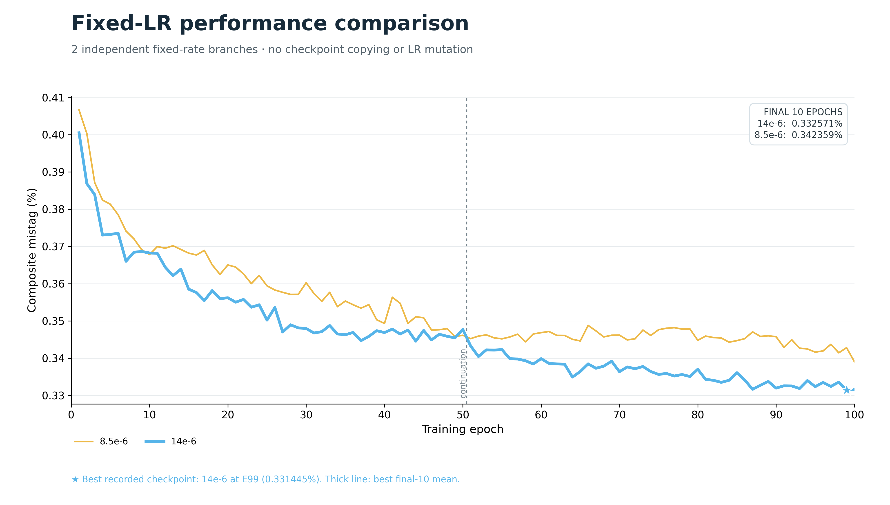
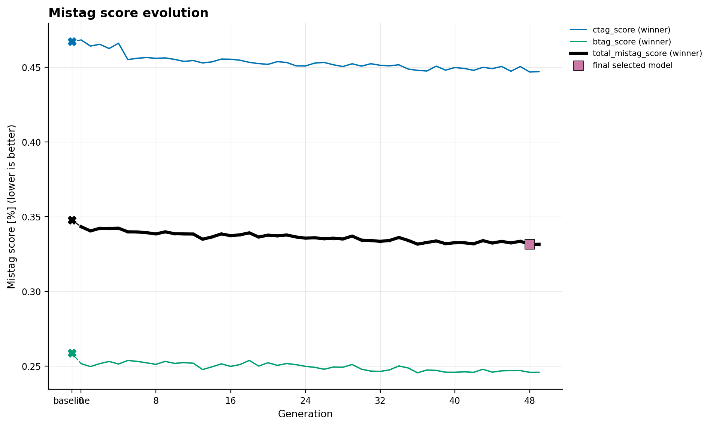
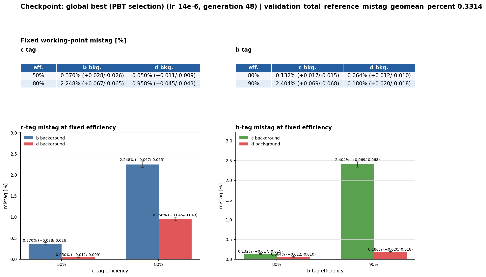

Fixed Learning Rate — 100 epochs
================================

Two fixed-learning-rate members continued from epoch 50 to epoch 100.

Result summary
--------------

Two of the five fixed-learning-rate members, 1.4 × 10\ :sup:`-5` (the best member at epoch 50) and
8.5 × 10\ :sup:`-6`, were each continued from epoch 50 to epoch 100 as independent single-member
runs. The seed schedule continues that of the 50-epoch run (seed 12395 = 12345 + 50).

* Final-10 validation, epochs 91–100: ``0.332571`` (1.4 × 10\ :sup:`-5`) and ``0.342359``
  (8.5 × 10\ :sup:`-6`)
* Global best: ``0.331445`` (1.4 × 10\ :sup:`-5`, training epoch 99) and ``0.339059``
  (8.5 × 10\ :sup:`-6`, training epoch 100)
* Independent holdout of the 1.4 × 10\ :sup:`-5` global best: ``0.315582`` (:doc:`../results`)

These runs serve as the comparator for :doc:`pbt-v2-100`. Because the member was chosen after epoch 50
and is a single member rather than a population, that comparison is asymmetric (:doc:`../results`).

Key plots
---------

Metrics and history
-------------------

* :download:`Recorded metrics <../../published/experiments/fixed-lr-100/public/metrics.csv>`
* :download:`Learning-rate history <../../published/experiments/fixed-lr-100/lr_history.csv>`
* This run has no exploit history.

Models
------

No model checkpoint is included in this publication bundle.

Provenance and reproducibility
------------------------------

* Run directory (local, not published): ``runs/pbt/fixed_lr_continuation_20260917_lr_14e-6``
* Source commit: ``68cc7fbbb6d092ea4038c9c7f400c1780a938ef3``
* Source manifest SHA256: ``ff3e2d751a44d2649cd31a5a53f97c951021dfda283c6d07bde94fe02134e3cc``
* :download:`Resolved configuration <../../published/experiments/fixed-lr-100/public/config.yaml>`
* :download:`Publication provenance <../../published/experiments/fixed-lr-100/public/provenance.json>`
