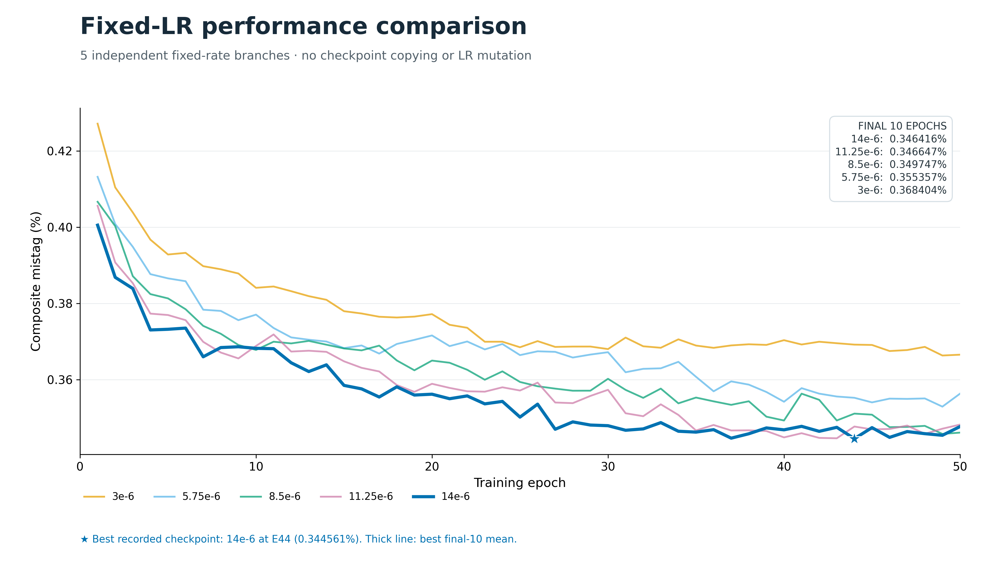
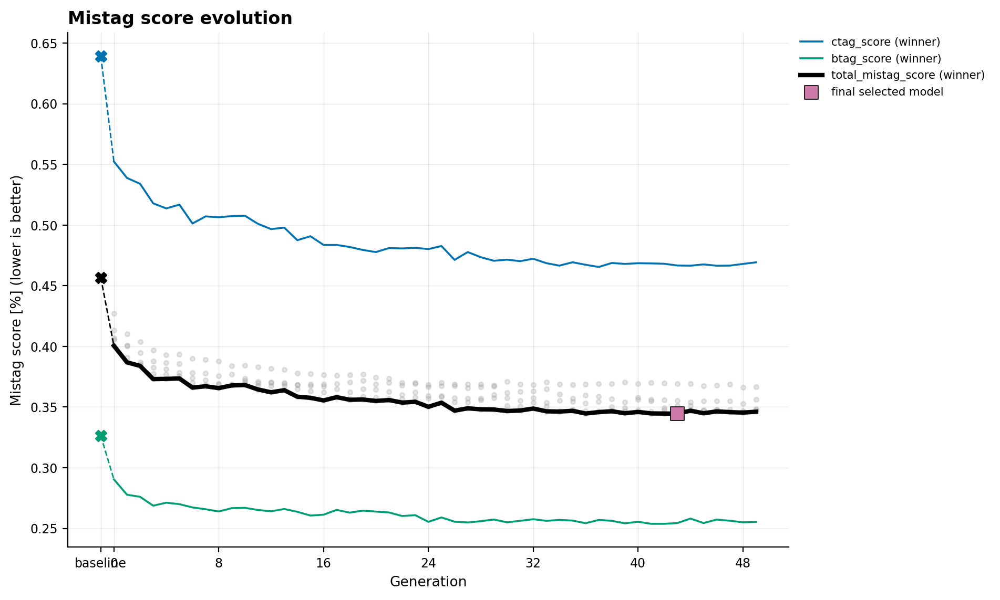
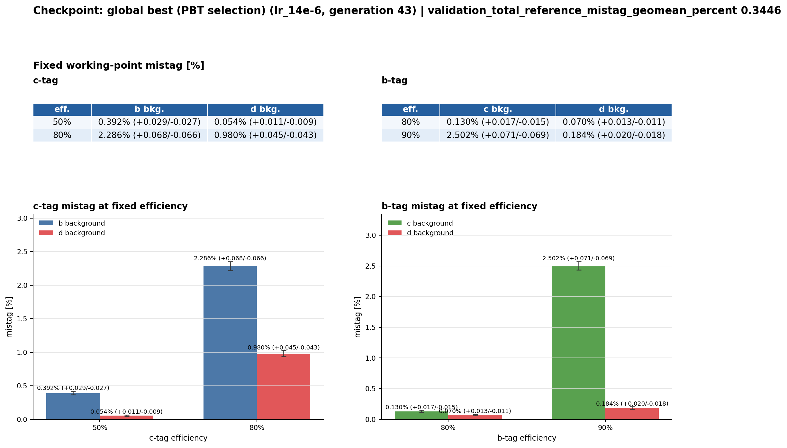

Fixed Learning Rate — 50 epochs
===============================

The matched five-member fixed-learning-rate population, comparator for windowed PBT at 50 epochs.

Result summary
--------------

* Status: completed; policy ``fixed_lr_grid``; seed 12345; 50 training epochs; five members with
  constant learning rates 3.0–14 × 10\ :sup:`-6`; no copies.
* Final-10 current-best validation (population endpoint, epochs 41–50): ``0.345568``
* Global best (selected checkpoint): ``0.344561``, member ``lr_14e-6`` at training epoch 44
* Starting checkpoint: ``0.456705``
* Independent holdout of the selected checkpoint: ``0.326934`` (:doc:`../holdout_evaluation`)

Key plots
---------

Metrics and history
-------------------

* :download:`Recorded metrics <../../published/experiments/fixed-lr-50/public/metrics.csv>`
* :download:`Learning-rate history <../../published/experiments/fixed-lr-50/lr_history.csv>`
* This run has no exploit history.

Models
------

No model checkpoint is included in this publication bundle.

Provenance and reproducibility
------------------------------

* Run directory (local, not published): ``runs/pbt/foundation_fixed_lr_50epochs_20260916``
* Source commit: ``e2a70c6775ca0896942d2c2fb8a481c7be5fdb5e``
* Source manifest SHA256: ``ac32758770f4755ef7cdaec3fe4342760105830b83b8d01438bb2643038766b8``
* :download:`Resolved configuration <../../published/experiments/fixed-lr-50/public/config.yaml>`
* :download:`Publication provenance <../../published/experiments/fixed-lr-50/public/provenance.json>`

Downloads are path-free copies of the recorded bundle files (``published/experiments/fixed-lr-50/public/``). Model epochs in file descriptions are Weaver checkpoint epochs, equal to the training epoch plus 17.
