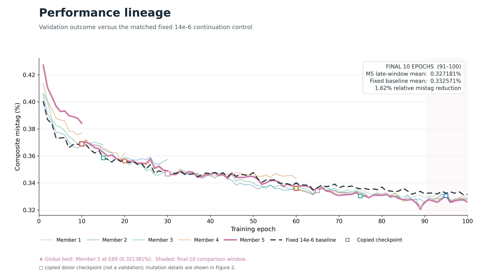
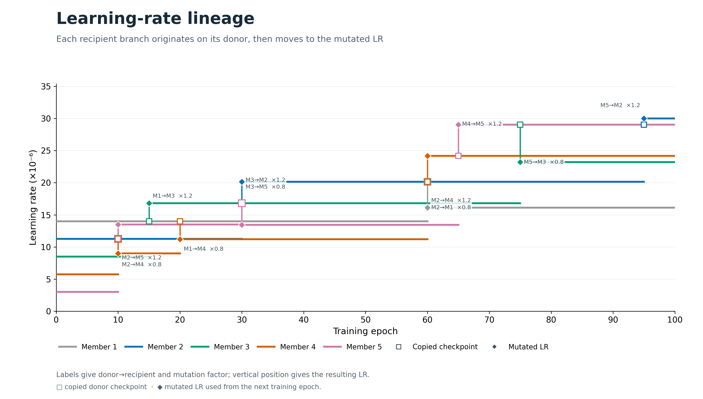

Windowed PBT — 100 epochs
=========================

The windowed-PBT population continued from epoch 50 to epoch 100.

Result summary
--------------

* Status: completed; policy ``windowed_pbt_v2``; seed 12345; 100 training epochs (continuation of
  :doc:`pbt-v2-50`); five members.
* Final-10 current-best validation (population endpoint, epochs 91–100): ``0.326944``
* Global best (selected checkpoint): ``0.321381``, member ``lr_3e-6`` at training epoch 89,
  learning rate 2.90304 × 10\ :sup:`-5`
* Applied copies: 11 over 100 epochs
* Independent holdout of the selected checkpoint: ``0.311050`` (:doc:`../results`)
* Comparator: the single fixed-learning-rate member 1.4 × 10\ :sup:`-5`, final-10 ``0.332571``
  (:doc:`fixed-lr-100`). Difference −0.005627 pp (−1.69%). The comparison is asymmetric: the
  comparator is one member chosen after epoch 50, not a population.

The annotation box in the first figure predates a correction: its 0.327181% (1.62%) is the
``lr_3e-6`` member's final-10 mean, not the population endpoint (:doc:`../results`).

Key plots
---------

Metrics and history
-------------------

* :download:`Recorded metrics <../../published/experiments/pbt-v2-100/public/metrics.csv>`
* :download:`Learning-rate history <../../published/experiments/pbt-v2-100/lr_history.csv>`
* :download:`Exploit history <../../published/experiments/pbt-v2-100/public/exploit_history.csv>`

Models
------

* ``best_single_state.pt`` — epoch 106, lowest recorded individual metric, SHA256 ``9dd5319c225603dd29fcd6a0cb33a72f2b5610d62e8bf2dda96174209dd6691d``
* ``protected_best_state.pt`` — epoch 107, best protected window selection, SHA256 ``453f5de6edacad6fff221288b21a70642eb77210ec9e8db48f9d045ce91fe121``
* ``final_best_state.pt`` — epoch 117, top-ranked member at the final horizon, SHA256 ``7818184249838cc70bc58dc3e3a556ec0655071e747fa42a58201f78ba9bdad6``

Model files are prepared as release assets and are intentionally excluded from the Pages build.

Provenance and reproducibility
------------------------------

* Run directory (local, not published): ``runs/pbt/windowed_pbt_v2_100epochs``
* Source commit: ``59b9a3a92b5f8b2241817a1facbc71e097e13fdd``
* Source manifest SHA256: ``6baf6613787787635b054043a453b0334726fc2bb446178d48e9d790ecb64bb8``
* :download:`Resolved configuration <../../published/experiments/pbt-v2-100/public/config.yaml>`
* :download:`Publication provenance <../../published/experiments/pbt-v2-100/public/provenance.json>`
