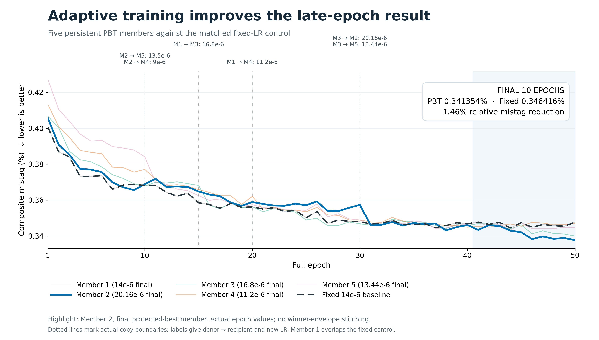
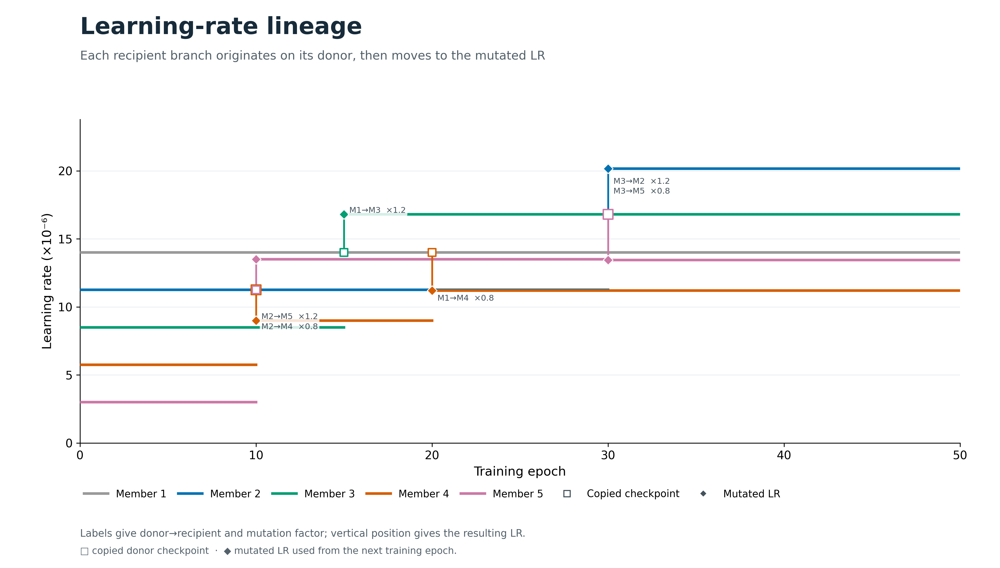

Windowed PBT — 50 epochs
========================

Windowed PBT over 50 training epochs. Its final state is the starting point of the 100-epoch continuation.

Result summary
--------------

* Status: completed; policy ``windowed_pbt_v2``; seed 12345; 50 training epochs; five members.
* Final-10 current-best validation (population endpoint, epochs 41–50): ``0.341219``
* Global best (selected checkpoint): ``0.337727``, member ``lr_11_25e-6`` at training epoch 50,
  learning rate 2.016 × 10\ :sup:`-5`
* Applied copies: 6
* Starting checkpoint: ``0.456705``
* Independent holdout of the selected checkpoint: ``0.322484`` (:doc:`../holdout_evaluation`)
* Matched comparator: :doc:`fixed-lr-50` (:doc:`../results`)

Key plots
---------

Metrics and history
-------------------

* :download:`Recorded metrics <../../published/experiments/pbt-v2-50/public/metrics.csv>`
* :download:`Learning-rate history <../../published/experiments/pbt-v2-50/lr_history.csv>`
* :download:`Exploit history <../../published/experiments/pbt-v2-50/public/exploit_history.csv>`

Models
------

* ``best_single_state.pt`` — epoch 67, lowest recorded individual metric, SHA256 ``e29d7a766993d37172f6901992d4dbd35321946f491cb4f3adb33f0556246837``
* ``protected_best_state.pt`` — epoch 67, best protected window selection, SHA256 ``e29d7a766993d37172f6901992d4dbd35321946f491cb4f3adb33f0556246837``
* ``final_best_state.pt`` — epoch 67, top-ranked member at the final horizon, SHA256 ``e29d7a766993d37172f6901992d4dbd35321946f491cb4f3adb33f0556246837``

Model files are prepared as release assets and are intentionally excluded from the Pages build.

Provenance and reproducibility
------------------------------

* Run directory (local, not published): ``runs/pbt/windowed_pbt_v2``
* Source commit: ``a4f750793911508812b5b09296afe5306306c930``
* Source manifest SHA256: ``fb1964a8f2d6d087008297ffad1ac3dac6499ecb156079de41d0c9e5e7e523b6``
* :download:`Resolved configuration <../../published/experiments/pbt-v2-50/public/config.yaml>`
* :download:`Publication provenance <../../published/experiments/pbt-v2-50/public/provenance.json>`

Downloads are path-free copies of the recorded bundle files (``published/experiments/pbt-v2-50/public/``). Model epochs in file descriptions are Weaver checkpoint epochs, equal to the training epoch plus 17.
