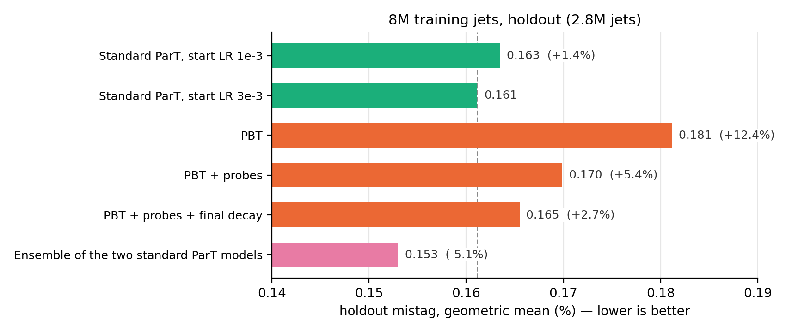

Adaptive Learning-Rate Training for ILC Jet-Flavour Tagging
===========================================================

A pretrained Particle Transformer (ParT) separates b, c and light-quark jets in simulated
ILC events. This project asks whether adapting the learning rate during fine-tuning, with
Population Based Training (PBT), gives a better tagger than standard ParT training (Weaver's
flat+decay learning-rate schedule), and whether any gain holds on data never used for model
selection. All results are on a 2.8M-jet holdout that is used only after the checkpoints are
fixed.

Findings
--------

1. **On 800k training jets PBT wins.** With three training seeds and the same compute, PBT
   gives a lower composite mistag than standard ParT on every seed: 0.67%, 0.85% and 0.91%;
   0.81% on average, 95% interval 0.34–1.34% for the holdout sample
   (:ref:`pbt-vs-standard-part`).
2. **On 8M training jets PBT loses.** It is 12.4% worse than standard ParT (one seed), because
   it lowers the learning rate too early (:ref:`pbt-vs-standard-part-8m`). Cool-down probes and
   a final decay close 78% of the gap, to 2.7% (:ref:`probe-scored-pbt`).
3. **The reason is overfitting.** At 800k the model starts to memorise its training data, and
   lowering the learning rate early helps. At 8M it does not overfit, and a long phase at a high
   learning rate followed by a decay is better (:ref:`no-overfitting-at-8m`).
4. **An ensemble of two standard ParT models is 5.05% better** on the 8M holdout than the
   better single model (interval 3.75–6.36%; one seed, development result). Both models are
   members of the learning-rate scan that standard ParT training runs anyway
   (:ref:`prediction-ensemble`).

   Holdout composite mistag on 8M training jets (lower is better).

Corrected: earlier gains of 1–2% and 7.7% were measured against fixed learning rates that were
too low (:ref:`correction-of-earlier-comparisons`). Inconclusive: whether adapting more often
helps (:ref:`adaptation-frequency`).

Contents
--------

.. toctree::
   :maxdepth: 1

   results
   ongoing
   method
   evaluation
   reproducibility

* :doc:`results`: all completed comparisons, the 8M study, supporting studies and limitations.
* :doc:`ongoing`: tests in progress.
* :doc:`method`: data, model, training and the learning-rate policies.
* :doc:`evaluation`: splits, metrics, endpoints and statistical rules used everywhere.
* :doc:`reproducibility`: repository map, commands, experiment records and history.
