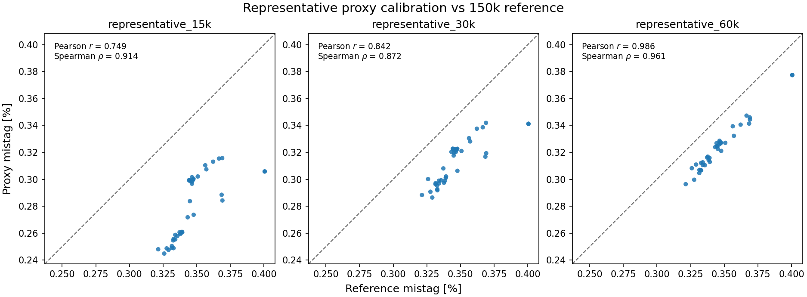
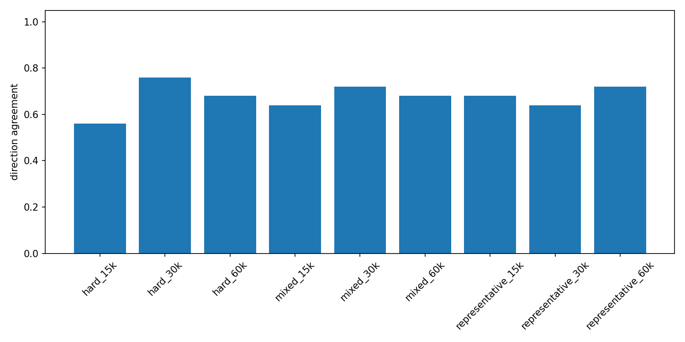
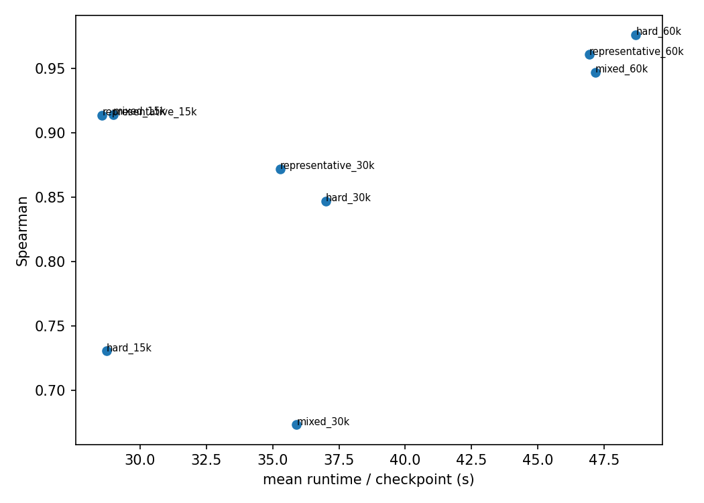
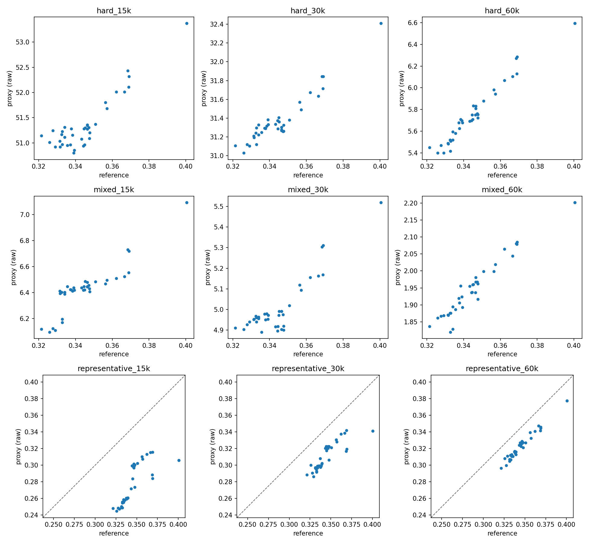
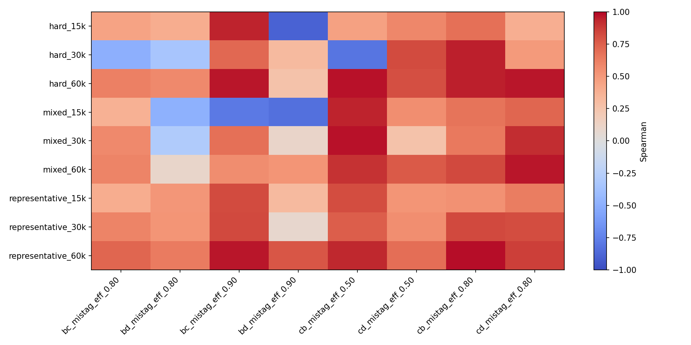

Supporting Study: Validation-Proxy Qualification
================================================

Validating every member on the full 150,000-jet selection validation set
(:doc:`evaluation`) is too expensive to repeat many times per epoch, as an adaptive
learning-rate controller reacting within an epoch would require. This offline
study tested whether a smaller, frozen subset of that set tracks the full
measurement well enough. Nine candidate subsets were evaluated on 38 saved model
states spanning weak to strong checkpoints of earlier fixed-learning-rate and PBT
runs. No model was trained and no learning rate was changed. The qualified choice is
**representative_60k**. In this page *reference* means the full selection
validation set.

Calibration against the reference
---------------------------------

   Each point is one checkpoint. X is the reference mistag, Y is proxy
   mistag, and the dashed line is perfect absolute calibration.

The 60k relationship is visibly tighter than at 15k or 30k:
``representative_60k`` reaches **Pearson 0.986** and **Spearman 0.961**.
Pearson measures linear agreement; Spearman measures whether checkpoint ranking
is preserved. The points remain below the diagonal, so the proxy is useful for
comparison but is not a perfectly calibrated replacement for the reference.

What was tested
---------------

.. list-table:: Compact experiment design
   :header-rows: 0
   :widths: 24 76

   * - **Reference**
     - 150,000 jets = 50,000 each of b, c and light (d)
   * - **Checkpoint panel**
     - 38 unique model states from fixed-LR and PBT trajectories
   * - **Candidates**
     - representative / hard / mixed × 15k / 30k / 60k = 9 proxies
   * - **Total**
     - 38 × 9 = 342 evaluations
   * - **Representative**
     - Deterministic, class-balanced sample
   * - **Hard**
     - Difficult jets, enriched by the predictive entropy of a frozen anchor model
   * - **Mixed**
     - 70% representative + 30% hard

Can it follow a changing trajectory?
------------------------------------

Ranking different checkpoints is not enough: a controller must also detect
whether the same trajectory just improved or degraded. For
``representative_60k``, temporal direction agreement is **0.720**. A future
controller must therefore use smoothing, short-window trends and patience
rather than react to one measurement.

Is it cheap enough to use frequently?
-------------------------------------

``representative_60k`` takes **46.93 s** per checkpoint, is **5.33× faster**
than the reference evaluation and retains **Spearman 0.961**. This is the
practical cost/quality trade-off needed for measurements between epoch-level
decisions.

Why ``representative_60k``
--------------------------

**Selected proxy: representative_60k**

* Pearson **0.986**; Spearman **0.961**
* Pairwise agreement **0.919**; temporal agreement **0.720**
* Zero observed best-checkpoint regret
* **5.33×** faster than the full reference
* Only candidate satisfying the complete predeclared qualification rule

``hard_60k`` has slightly stronger pure ranking (Spearman 0.976; pairwise
0.940), but worse temporal agreement (0.680), non-zero regret, and a
distribution-shifted hard-enriched raw metric. The selection was therefore not
simply “take the highest correlation.”

Scope
-----

The study establishes that ``representative_60k`` is a qualified, cheaper measurement
signal. It does not show that adaptive learning-rate control improves training; the
controller audit that used it is described in :doc:`exploratory_studies`.

Technical details
-----------------

Full results
~~~~~~~~~~~~

.. list-table:: Proxy qualification results
   :header-rows: 1
   :widths: 18 9 9 16 10 10 10 18

   * - Proxy
     - Pearson
     - Spearman
     - Spearman 95% CI
     - Pairwise
     - Temporal
     - Regret (pp)
     - Runtime / speedup
   * - ``representative_15k``
     - 0.749
     - 0.914
     - 0.591–0.967
     - 0.893
     - 0.680
     - 0.0045
     - 28.57 s / 8.76×
   * - ``hard_15k``
     - 0.928
     - 0.730
     - 0.347–0.912
     - 0.781
     - 0.560
     - 0.0177
     - 28.74 s / 8.71×
   * - ``mixed_15k``
     - 0.920
     - 0.914
     - 0.170–0.942
     - 0.889
     - 0.640
     - 0.0045
     - 28.99 s / 8.63×
   * - ``representative_30k``
     - 0.842
     - 0.872
     - 0.426–0.959
     - 0.857
     - 0.640
     - 0.0077
     - 35.28 s / 7.09×
   * - ``hard_30k``
     - 0.962
     - 0.847
     - 0.224–0.963
     - 0.848
     - 0.760
     - 0.0045
     - 37.01 s / 6.76×
   * - ``mixed_30k``
     - 0.918
     - 0.673
     - −0.300–0.957
     - 0.776
     - 0.720
     - 0.0142
     - 35.90 s / 6.97×
   * - ``representative_60k``
     - 0.986
     - 0.961
     - 0.847–0.975
     - 0.919
     - 0.720
     - 0.0000
     - 46.93 s / 5.33×
   * - ``hard_60k``
     - 0.981
     - 0.976
     - 0.943–0.980
     - 0.940
     - 0.680
     - 0.0077
     - 48.70 s / 5.14×
   * - ``mixed_60k``
     - 0.969
     - 0.947
     - 0.635–0.969
     - 0.920
     - 0.680
     - 0.0114
     - 47.17 s / 5.30×

Qualification and uncertainty
~~~~~~~~~~~~~~~~~~~~~~~~~~~~~

The predeclared rule required Spearman ≥ 0.8, pairwise agreement ≥ 0.8,
temporal direction agreement ≥ 0.7, and a bootstrap Spearman 95% lower bound
≥ 0.5. ``representative_60k`` was the only candidate satisfying all four.

Ranking uncertainty used 50 paired, class-stratified bootstrap replicates
per candidate, resampling jets within each class with identical indices for every
checkpoint. Without event identifiers this is a jet-level bootstrap; it measures the
stability of the ranking, not an event-level uncertainty. All 450
planned replicates completed. All 72 candidate/working-point statistic blocks
were also computed.

Integrity and reproducibility
~~~~~~~~~~~~~~~~~~~~~~~~~~~~~

The 38-state panel was deduplicated by model-state SHA256 and deliberately
included weak, medium, strong, intermediate, final, protected and global-best
states. Proxy membership was frozen before evaluation, so every checkpoint saw
the same jets within one candidate.

All 342 checkpoint/proxy results were checked for checkpoint SHA, proxy
manifest SHA, required metrics, and prediction parquet existence, schema and
row count. No canonical checkpoint or source-run manifest was modified.
Construction and qualification are implemented in
``scripts/validation/build_proxy_sets.py`` and
``scripts/validation/qualify_proxy.py``. The finalized
:download:`qualification summary <_static/proxy_validation/qualification_summary.json>`
is published as JSON.

Supplementary figures
~~~~~~~~~~~~~~~~~~~~~

Hard and mixed proxies are distribution-enriched, so their raw vertical scales
are not directly calibrated to the natural reference distribution.

   Representative, hard and mixed proxy scatter plots at all three sizes.

The per-working-point heatmap checks whether aggregate agreement hides behavior
at individual b-tag and c-tag operating points.

