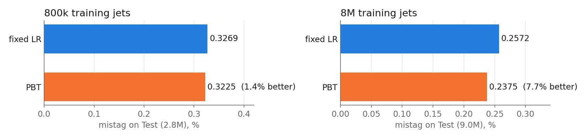
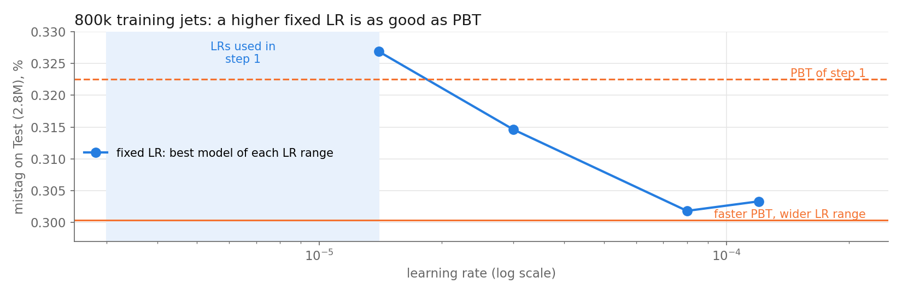
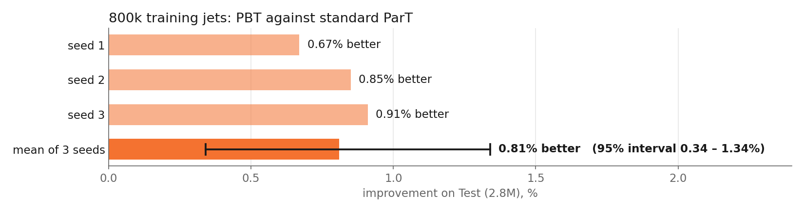
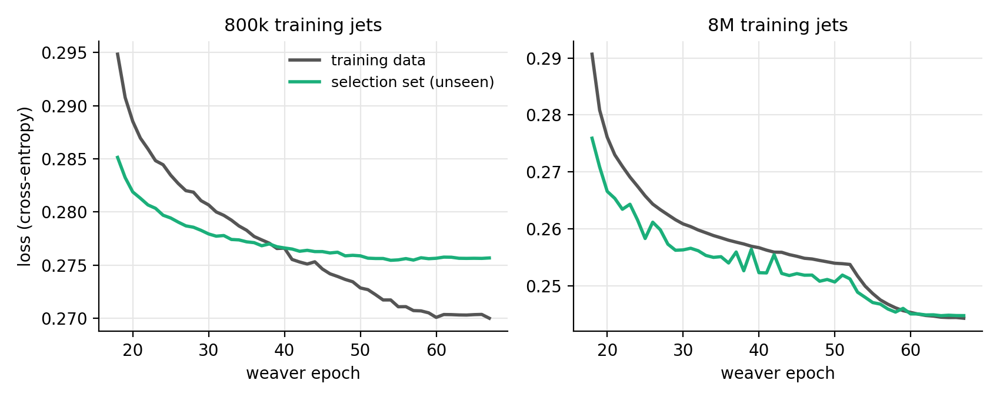
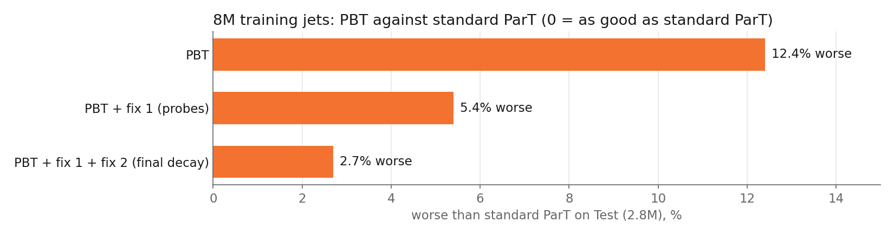
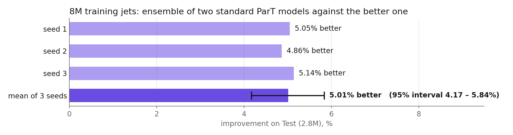

.. _report:

Report: All Trials and Results
==============================

.. warning::

   **Historical page (26 November 2026).** This is an earlier summary with abbreviated trial
   descriptions. The audited account is the `research report <overview.html>`_, with every run in
   the `experiment log <log.html>`_; where the two differ, those pages are correct. Corrections
   made since: trial 13's best LR was again the top of its grid; trial 16 used a different
   constant-LR grid from trial 14; trial 21 improved Validation slightly for standard ParT and was
   not evaluated on Test; trial 26 changed the final decay and the LR range together; the link
   between overfitting and the PBT result is a hypothesis.

Status on 2026-11-26. No run is in progress. The project asks one question: does PBT, which
changes the learning rate (LR) during training, give a better jet tagger than normal training?

**Answer in one line:** only a little (0.8%), and only with little training data. With much
training data a simple ensemble of two normally trained models is better (5%), and PBT is worse.

The story has five steps. Each step has one figure. All details (33 trials, 42 runs, dates,
configurations) are in :ref:`report-details` at the end. Words are explained in
:ref:`report-terms`.

.. _report-step-1:

Step 1 (September – October): PBT seems to win
-----------------------------------------------

We compared PBT with training at a fixed (constant) LR. PBT was better: by 1.4% on 800k training
jets and by 7.7% on 8M training jets.

.. _report-step-2:

Step 2 (early November): the win was not real
---------------------------------------------

The fixed LRs of step 1 were too low. We trained with higher fixed LRs: the best one (8×10⁻⁵, about six
times the highest LR of step 1) is as good as PBT. So PBT won in step 1 because it moved to a higher LR, not because
it adapts the LR. We also found that the Validation set (150k jets) was too small to select models
reliably, and changed to 1M jets.

.. _report-step-3:

Step 3 (mid November): a fair test on 800k jets — PBT wins a little
--------------------------------------------------------------------

We compared PBT with standard ParT, the normal training recipe of this model, on three random
seeds. PBT is better on every seed, by 0.81% on average. The gain is small, but it is real.

.. _report-step-4:

Step 4 (mid – late November): on 8M jets PBT loses
--------------------------------------------------

With ten times more training data, PBT is 12.4% worse than standard ParT. Two fixes reduce this
to 2.7%, but PBT stays worse.

The reason: on 8M jets the model does not overfit, so the best plan is a high LR for a long time
and a decay at the end. PBT judges each change after only two epochs. Over two epochs a lower LR
almost always looks better, so PBT lowers the LR too early. On 800k jets the model overfits, and an early
low LR is correct; this is why PBT wins there. The figure below shows this: on 800k jets the
loss on the training data falls below the loss on Validation (the model memorises its training
data); on 8M jets the two stay together.

   Loss per epoch of the best standard ParT model (weaver epoch 18 is training epoch 1).

.. _report-step-5:

Step 5 (late November): what works on 8M jets — an ensemble
-----------------------------------------------------------

An ensemble takes the mean of the outputs of two models. Two standard ParT models (trained
separately, with start LRs 3×10⁻³ and 1×10⁻³) are 5.0% better together than the better one alone,
on each of three seeds. PBT is not needed for this. We could not keep the gain in one single model
(distillation and weight averaging gave no gain), and on 800k jets ensembles give no gain.

.. _report-interpretation:

Summary
-------

.. list-table::
   :header-rows: 1
   :widths: 24 38 38

   * -
     - 800k training jets
     - 8M training jets
   * - The model
     - overfits
     - does not overfit
   * - PBT against standard ParT
     - **0.8% better** (3 seeds)
     - **2.7–12.4% worse** (1 seed)
   * - Ensemble of two models
     - no gain
     - **5.0% better** (3 seeds)

.. _report-corrections:

Limits: the 8M PBT results have one seed. All trials start from one pretrained model. Test
(2.8M) was also used in diagnostics before step 3, so it is not fully unseen.

Earlier statements that changed: the 1.4% and 7.7% of step 1 were measured against constant LRs that were too low (step 2), and the
first 8M value, 10.8% worse, is 12.4% against the better standard ParT model.

.. _report-open:

Open items: PBT decisions inside an epoch (implemented, not run); ensembles of more than two
models; PBT decisions that look further ahead than two epochs. None is started.

.. _report-details:

Details
-------

.. figure:: ../published/results/report/timeline.png
   :alt: Time line of all trials, by phase, coloured by kind of run
   :width: 100%

   All trials by phase (JST). Phases 1–5 below map to the steps: phase 1–2 = step 1, phase 3 =
   step 2, phase 4 = step 3, phase 5 = steps 4 and 5.

.. _report-terms:

Words used
~~~~~~~~~~

.. list-table::
   :header-rows: 1
   :widths: 24 76

   * - Word
     - Meaning
   * - Training (800k), (8M)
     - Training data: 2.4M and 24M jets (source entries below 800k and 8M of each file).
   * - Validation (150k), (1M)
     - Data evaluated after each epoch. It selects the best model and drives PBT. 150k until
       2026-11-09, then 1M, because 150k was too small.
   * - Test (2.8M)
     - Data used only once per selected model, after the selection. Earlier name: "holdout".
   * - Test (9.0M)
     - Data used one time only, in trial 10. Earlier name: "sealed test".
   * - Mistag
     - The metric of all results (%): a mean of the background mistag rates at eight working
       points. Lower is better.
   * - Standard ParT
     - The usual LR schedule: constant for 35 epochs, then a decay by ×0.01 over 15 epochs.
   * - PBT
     - Population Based Training. Five models train in parallel. A weak model copies the
       weights of a strong model and changes its LR.
   * - Ensemble
     - The mean of the outputs of two models.

All trials start from the same pretrained model and train for 50 epochs, unless the table gives
a different number.

.. _report-trials:

All trials
~~~~~~~~~~

Outcome: ✅ better · ❌ worse · ➖ no clear difference · ⚠️ comparator LRs too low (the run itself is valid) ·
🔧 set-up or check. Values are on Test (2.8M) unless the cell says otherwise. Times are JST.
Every run with its selected model is listed in :ref:`report-runs`.

Phase 0 (Jul 22 – Aug 31) was set-up. We tested first PBT versions and LR controllers and fixed
two defects. These runs used an older training set-up and are not comparable.

.. raw:: html

   

<b>Show the 33 trials</b> (dates, runs, links)

.. include:: report_trials.inc

.. raw:: html

   

Run names link to the configuration files. GPU-h is the GPU time of all members of the trial's runs.
After phase 3 we changed to Validation (1M) and to standard ParT as the comparator, because with
Validation (150k) the selection noise (about 0.5%) was as large as the effect.

Details of each trial: :doc:`results`.

.. _report-runs:

All runs
~~~~~~~~

Every training run of trials 1–33. The selected model is the one with the best Validation value
over the run; the epoch counts from the pretrained start (1–50, or 51–100 for trial 2). For PBT the
name is the identity of a member, and the LR is the member's LR at that epoch; for standard ParT
the LR is the start LR (the schedule then lowers it). Validation is
Validation (150k) for trials 1–17 and Validation (1M) from trial 18. Download:
:download:`runs.csv <../published/results/report/runs.csv>`.

.. raw:: html

   

<b>Show the 42 runs</b>

.. include:: report_runs.inc

.. raw:: html

   

