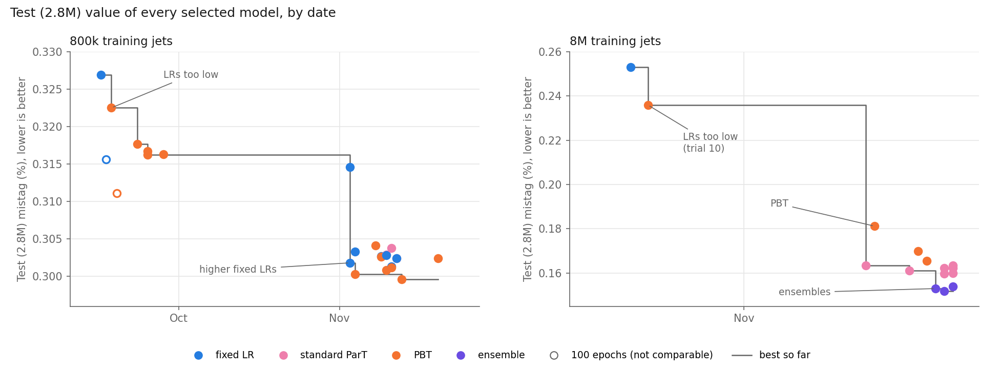
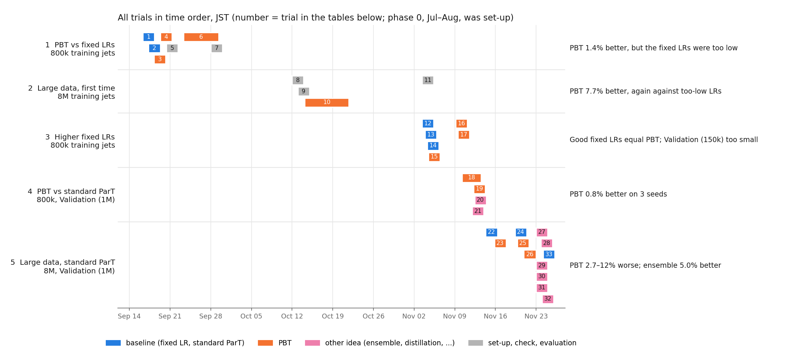

.. _report:

Report: All Trials and Results
==============================

Status on 2026-11-26. No run is in progress.

In one minute
-------------

* **PBT helps only with little data.** On 800k training jets, PBT is **0.8% better** than
  standard ParT on three seeds.
* **PBT is worse with much data.** On 8M training jets, PBT is **12.4% worse**. Two fixes reduce
  this to **2.7% worse**.
* **Most early gains were not real.** Before November, PBT was compared with fixed learning
  rates (LRs) that were too low. Good fixed LRs give the same result as PBT.
* **The useful result is an ensemble.** On 8M jets, the mean of two standard ParT models is
  **5.0% better** than the better single model, on three seeds. PBT is not necessary for it.

.. figure:: ../published/results/report/results.png
   :alt: Change of the Test (2.8M) mistag for every comparison of the project
   :width: 100%

   Every comparison of the project. Left of zero: the first named method is better. Hatched:
   the comparison is not valid, because the comparator's LRs were too low.

   The best Test (2.8M) value by date. Each dot is one selected model. The large improvements
   came from higher LRs (800k, early November) and from the change to standard ParT and
   ensembles (8M), not from PBT.

   All trials by phase. The numbers are the trial numbers of the tables below.

.. _report-terms:

Words used
----------

.. list-table::
   :header-rows: 1
   :widths: 24 76

   * - Word
     - Meaning
   * - Training (800k), (8M)
     - Training data: 2.4M and 24M jets (source entries below 800k and 8M of each file).
   * - Validation (150k), (1M)
     - Data evaluated after each epoch. It selects the best model and drives PBT. 150k until
       2026-11-09, then 1M, because 150k was too small.
   * - Test (2.8M)
     - Data used only once per selected model, after the selection. Earlier name: "holdout".
   * - Test (9.0M)
     - Data used one time only, in trial 10. Earlier name: "sealed test".
   * - Mistag
     - The metric of all results (%): a mean of the background mistag rates at eight working
       points. Lower is better.
   * - Standard ParT
     - The usual LR schedule: constant for 35 epochs, then a decay by ×0.01 over 15 epochs.
   * - PBT
     - Population Based Training. Five models train in parallel. A weak model copies the
       weights of a strong model and changes its LR.
   * - Ensemble
     - The mean of the outputs of two models.

All trials start from the same pretrained model and train for 50 epochs, unless the table gives
a different number.

.. _report-trials:

List of trials
--------------

Outcome: ✅ better · ❌ worse · ➖ no clear difference · ⚠️ not valid (comparator LRs too low) ·
🔧 set-up or check. Values are on Test (2.8M) unless the cell says otherwise. Times are JST.
Every run with its selected model is listed in :ref:`report-runs`.

Phase 0 (Jul 22 – Aug 31) was set-up. We tested first PBT versions and LR controllers and fixed
two defects. These runs used an older training set-up and are not comparable.

.. include:: report_trials.inc

Run names link to the configuration files. GPU-h is the GPU time of all members of the trial's runs.
After phase 3 we changed to Validation (1M) and to standard ParT as the comparator, because with
Validation (150k) the selection noise (about 0.5%) was as large as the effect.

Details of each trial: :doc:`results`.

.. _report-corrections:

What changed in earlier statements
----------------------------------

* **PBT 1.4% better (phase 1) and 7.7% better (trial 10):** both against fixed LRs that were too
  low. Against good fixed LRs (trial 13), the gain is about zero.
* **PBT 10.8% worse at 8M (first value):** it is 12.4% against the better standard ParT model
  (trial 24).

.. _report-interpretation:

Interpretation
--------------

.. list-table::
   :header-rows: 1
   :widths: 24 38 38

   * -
     - 800k training jets
     - 8M training jets
   * - The model
     - overfits (training loss falls, validation loss stops)
     - does not overfit
   * - Best LR schedule
     - lower the LR at the correct time
     - high LR for a long time, then a decay
   * - PBT
     - finds the correct time: **0.8% better**
     - lowers the LR too early: **2.7–12.4% worse**
   * - Ensemble of two models
     - no gain: the models are too similar
     - **5.0% better**

PBT judges each decision after two epochs. Over two epochs, a lower LR almost always looks
better. With much data this is wrong, because the high LR gives its benefit only after the
final decay.

Limits: the 8M PBT trials have one seed. All trials start from one pretrained model. Test (2.8M)
was used in diagnostics before trial 18, so it is not fully unseen.

.. _report-open:

Open items
----------

* PBT decisions inside an epoch (trial 11): implemented, not run.
* Decision frequency (trial 6): inconclusive.
* Possible next steps, not started: PBT decisions that look further ahead; ensembles of more
  than two models; other pretrained start models.

.. _report-runs:

All runs
--------

Every training run of trials 1–33. The selected model is the one with the best Validation value
over the run; the epoch counts from the pretrained start (1–50, or 51–100 for trial 2). For PBT the
name is the identity of a member, and the LR is the member's LR at that epoch. Validation is
Validation (150k) for trials 1–17 and Validation (1M) from trial 18. Download:
:download:`runs.csv <../published/results/report/runs.csv>`.

.. include:: report_runs.inc
