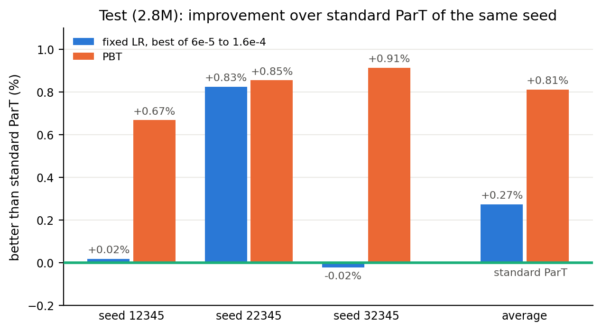
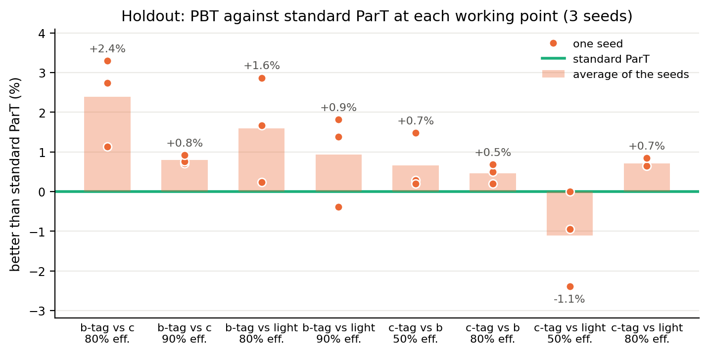
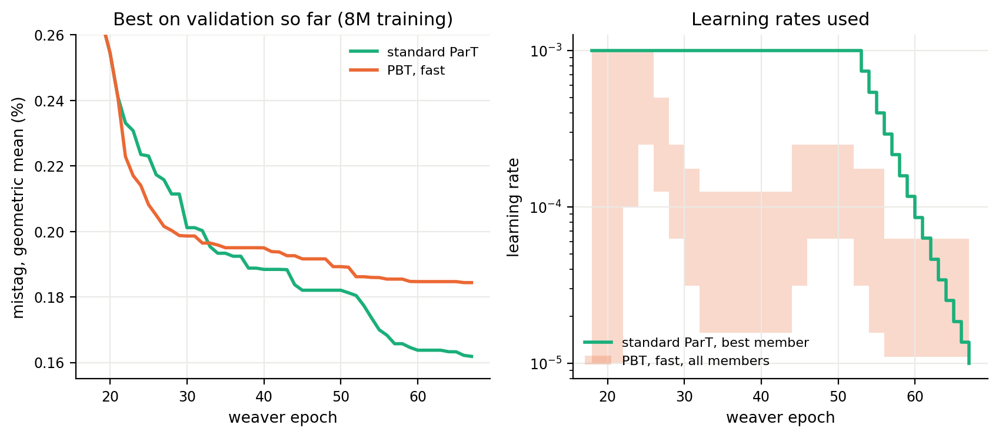
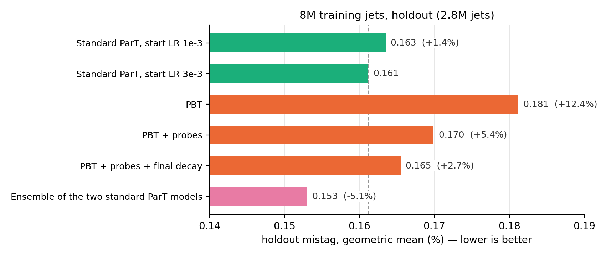
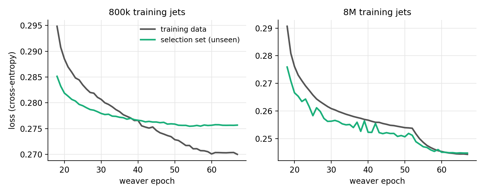
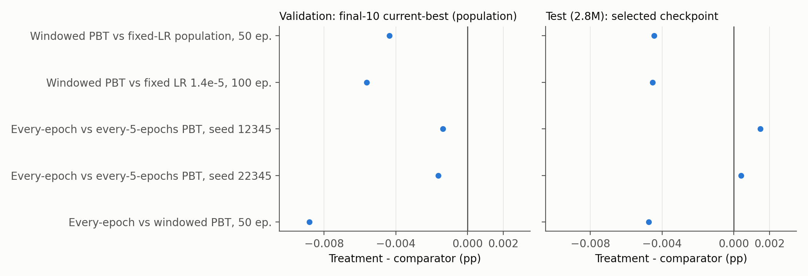
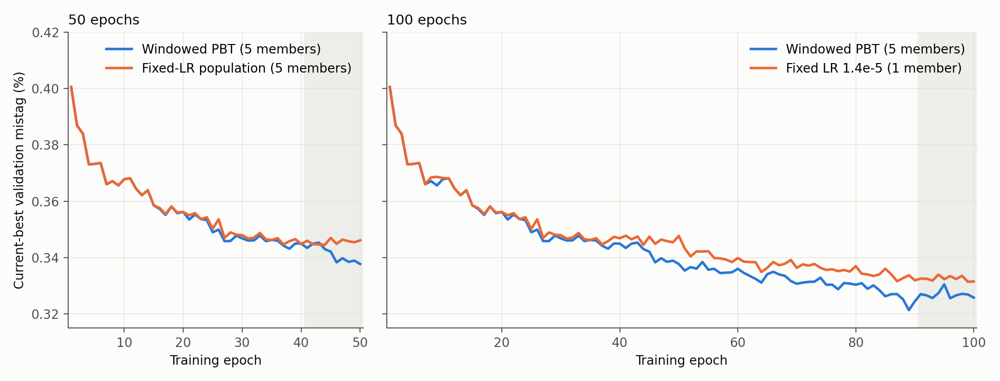
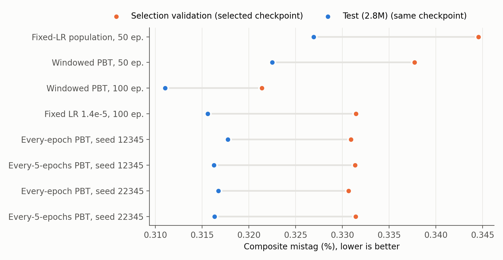
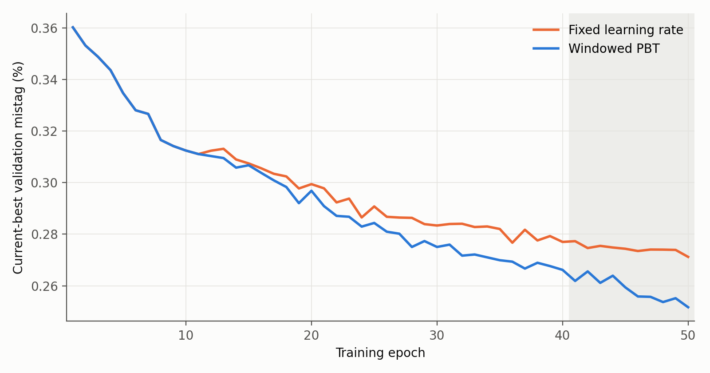
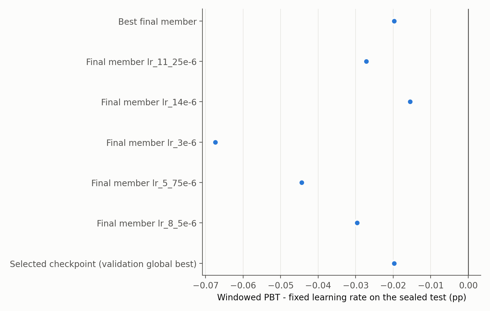

Results and Limitations
=======================

Composite mistag in percent; lower is better. Endpoints and splits are defined in
:doc:`evaluation`. All values are generated from the run manifests and the holdout
evaluation by :repo:`scripts/publish/export_results_summary.py`; tables, trajectories
and source hashes are in :repo:`published/results`.

.. _pbt-vs-standard-part:

PBT versus standard ParT training (current main result)
--------------------------------------------------------

**Result.** With three training seeds, the fast windowed PBT is better on the holdout than
standard ParT training on every seed: 0.67%, 0.85% and 0.91% lower composite mistag, 0.81% on
average (95% interval 0.34–1.34%, holdout sampling only). It is better at seven of eight
working points on average. A grid of constant learning rates is not stable: on one seed it is
as good as PBT, on the other two it is the same as standard ParT. On ten times more training
data (8M jets, one seed) the result reverses: PBT is 12.4% worse than standard ParT
(:ref:`pbt-vs-standard-part-8m`). Fixes close most but not all of that gap
(:ref:`probe-scored-pbt`); the reason is that the model overfits at 800k but not at 8M
(:ref:`no-overfitting-at-8m`).

**Runs.** Each seed has three runs. All start from the same pretrained checkpoint, train on the
same 800k jets for 50 epochs with five members, and therefore use the same compute. Each run
keeps the checkpoint (epoch and member) with the best value on a 1M-jet selection set, taken
from training-file rows that the 800k training does not use. The 2.8M-jet holdout is used only
afterwards, once per checkpoint; the holdout specifications were committed before training and
the selected checkpoints were frozen before the holdout evaluation
(:repo:`configs/prepared/holdout_sel1m_v1`, :repo:`configs/prepared/holdout_sel1m_seed32345_v1`).

* **Standard ParT**: Weaver's flat+decay learning-rate schedule (constant, then ×0.01 over the
  last 15 epochs), restarted from the pretrained checkpoint with start learning rates 1×10⁻⁵,
  3×10⁻⁵, 1×10⁻⁴, 3×10⁻⁴ and 1×10⁻³. The best member was the 1×10⁻⁴ one for every seed.
* **Constant learning rates**: five members from 6×10⁻⁵ to 1.6×10⁻⁴.
* **Fast windowed PBT**: five members starting log-spaced over 1×10⁻⁵–3.5×10⁻⁴, bounds
  5×10⁻⁶–5×10⁻⁴, decisions every two epochs from epoch 4, mutation ×0.5 or ×2, and fallback
  copies (×0.7 or ×1.4) when both mutations give a learning rate already in use.

.. list-table:: Holdout composite mistag (%), selected checkpoints
   :header-rows: 1
   :widths: 25 18 18 18 21

   * - Seed
     - Standard ParT
     - Constant LRs
     - Fast PBT
     - PBT − standard (95% interval)
   * - 12345
     - 0.3029
     - 0.3028
     - 0.3008
     - −0.67% (−1.50, +0.05)
   * - 22345
     - 0.3038
     - 0.3013
     - 0.3012
     - −0.85% (−1.43, −0.24)
   * - 32345
     - 0.3024
     - 0.3024
     - 0.2996
     - −0.91% (−1.75, −0.15)
   * - Mean of the seeds
     -
     -
     -
     - **−0.81% (−1.34, −0.34)**

   Holdout improvement over standard ParT of the same seed; the green line is standard ParT.

   The same comparison at each working point: bar, mean of the seeds; dots, single seeds. The
   exception is c-tag against light jets at 50% efficiency (1.1% worse on average).

**Intervals.** The holdout files have no event identifier, but the jets of one event are
adjacent rows: the invariant mass of two adjacent jets peaks at the Higgs mass, and that of two
random jets does not. The intervals resample blocks of 100 adjacent rows of one file with the
same draws for both checkpoints (and, for the mean, for all seeds), so the jets of an event stay
together. They do not change with the block size between 1 and 1000 rows. They describe the
holdout sample for these fixed checkpoints, not seed-to-seed variation, which the three seeds
show directly (:repo:`scripts/experiments/holdout_block_bootstrap.py`,
:repo:`published/results/sel1m`).

**What did not help.** Adding Weaver's final decay to PBT (no decisions in the last 15
epochs) selected the same checkpoints as PBT without it. Weight averaging of nearby checkpoints
or of population members did not improve on the plain selected checkpoint. Training standard
ParT from random initialization reached only 0.378 on the selection set, against about 0.30
from the pretrained checkpoint.

.. _pbt-vs-standard-part-8m:

On 8M training jets
~~~~~~~~~~~~~~~~~~~

The same comparison with the 8M training set (``train8m`` without the selection-set rows), one
seed (12345), the same selection set and holdout, standard ParT and fast PBT only
(:repo:`configs/prepared/holdout_sel1m_train8m_v1`). Standard ParT trained first, then PBT.
Because the best standard ParT member had the highest start learning rate, one more
standard ParT member with start learning rate 3×10⁻³ trained afterwards; its holdout
specification was committed before it started and fixes that the 8M standard ParT result is
the better of the two on the selection set
(:repo:`configs/prepared/holdout_sel1m_train8m_lr3e-3_v1`).

One change was made after standard ParT had trained 31 of 50 epochs and before PBT started. On
8M jets standard ParT was best at its highest start learning rate, 1×10⁻³, above the PBT upper
bound of 5×10⁻⁴ used at 800k. PBT therefore got the learning-rate range of standard ParT: the
same five start learning rates (1×10⁻⁵–1×10⁻³) and an upper bound of 1×10⁻³
(:repo:`configs/experiments/sel1m_train8m_fast_pbt.yaml`). The other PBT rules are unchanged.

.. list-table:: Composite mistag (%), selected checkpoints, 8M training jets
   :header-rows: 1
   :widths: 30 25 25 20

   * - Run
     - Selection set (1M)
     - Holdout (2.8M)
     - Selected epoch
   * - Standard ParT (start LR 3×10⁻³)
     - 0.1584
     - **0.1611**
     - 67 (last)
   * - Standard ParT (start LR 1×10⁻³)
     - 0.1619
     - 0.1635
     - 67 (last)
   * - Fast PBT
     - 0.1844
     - 0.1812
     - 66
   * - PBT − standard (3×10⁻³)
     - +16.4%
     - **+12.4%**
     -

   Left: best value on the selection set so far. Right: learning rate of the standard ParT
   member with start learning rate 1×10⁻³, and the range of learning rates of the PBT members.

The 3×10⁻³ member is 1.4% better on the holdout than the 1×10⁻³ member (0.1611 against
0.1635) and also better on the selection set, so it is the 8M standard ParT result.

PBT was ahead until about epoch 33, then fell behind; standard ParT gained most in its final
decay (0.180 at epoch 52, 0.162 at epoch 67). The likely cause is the short decision horizon:
PBT compares members two epochs after each decision, and over two epochs a lower learning rate
almost always looks better. PBT therefore lowered all learning rates early (at most 2.5×10⁻⁴ from
epoch 28, 1.1×10⁻⁵–6.3×10⁻⁵ at the end), while standard ParT kept 1×10⁻³ for 35 epochs and
decayed only at the end. At 800k this cost little; with ten times more data, the long phase
at a high learning rate is worth more than the early gains. This is one seed and one PBT
configuration. The difference is far larger than the holdout sampling intervals of the 800k
comparison, so no interval was computed. The changes to PBT that address the horizon are in
:ref:`probe-scored-pbt`, and the reason why 8M differs from 800k is in
:ref:`no-overfitting-at-8m`.

.. _probe-scored-pbt:

Fixes tried on 8M: cool-down probes and a final decay
~~~~~~~~~~~~~~~~~~~~~~~~~~~~~~~~~~~~~~~~~~~~~~~~~~~~~

Two changes address the short decision horizon. Each was fixed in a holdout specification
before its run started (:repo:`configs/prepared/holdout_sel1m_probe_v1`,
:repo:`configs/prepared/holdout_sel1m_probe_decay_v1`).

* **Cool-down probes.** At each decision a copy of every member trains a quarter epoch at
  0.1× its learning rate, and the decision ranks the members on these copies. A high learning
  rate is then judged after a short decay, which is where its benefit shows. The copies never
  return to the population and are never selected
  (:repo:`scripts/training/pbt/planning/window_probe.py`). The probe settings were chosen after
  the 8M result and are not tuned.
* **Final decay.** In the last 15 of 50 epochs PBT makes no decisions, and every member's
  learning rate decays by ×0.01 as in standard ParT. This run also had the learning-rate range of
  standard ParT including 3×10⁻³.

.. list-table:: Holdout composite mistag (%), 8M training jets, seed 12345
   :header-rows: 1
   :widths: 46 18 36

   * - Run
     - Holdout
     - Against standard ParT (3×10⁻³)
   * - Standard ParT, start LR 3×10⁻³
     - **0.1611**
     -
   * - PBT
     - 0.1812
     - +12.4%
   * - PBT + probes
     - 0.1699
     - +5.4%
   * - PBT + probes + final decay
     - 0.1655
     - +2.7%

   Holdout composite mistag on 8M training jets; the dashed line is standard ParT at start
   learning rate 3×10⁻³. The ensemble is described in :ref:`prediction-ensemble`.

The probes kept the learning rates high (1.2×10⁻⁴–1×10⁻³ instead of below 2.5×10⁻⁴), and the
final decay added the gain that standard ParT gets at the end. Together they closed 78% of the
gap (from 12.4% to 2.7%), but PBT is still worse than standard ParT. In epochs 44–51 the probes
again preferred lower learning rates (down to 1.3×10⁻⁴), so the final decay started from lower
learning rates than 3×10⁻³. A probe at 0.1× the member's own learning rate for a quarter epoch
is a much shorter and weaker decay than the real one (×0.01 over 15 epochs), so it still favours
low learning rates.

At 800k the probes changed little: 0.3024 on the holdout, against 0.3029 for standard ParT and
0.3008 for PBT without probes (seed 12345).

These are development runs: seed 12345 and the 8M training set had already been used for
earlier PBT variants. Configurations and a holdout specification for two new seeds were committed
in advance, with the rule that they run only if the last run is not clearly worse than standard
ParT (:repo:`configs/prepared/holdout_sel1m_train8m_seeds_v1`). At +2.7% it is clearly worse, so
the new seeds were not started.

.. _no-overfitting-at-8m:

Why 8M differs from 800k: the model does not overfit
~~~~~~~~~~~~~~~~~~~~~~~~~~~~~~~~~~~~~~~~~~~~~~~~~~~~

The loss on the training data and on the selection set (data the model never trains on) shows
the difference between the two training sets.

   Loss per epoch of the best standard ParT member (start learning rate 1×10⁻⁴ at 800k,
   3×10⁻³ at 8M), on the training data and on the selection set.

* **800k:** from about epoch 40 the training loss keeps falling (0.270 at the end) while the
  selection-set loss almost stops (0.276). The model starts to memorise its training data
  (overfitting), and lowering the learning rate early and keeping the best checkpoint helps.
  This is what PBT does, and it wins.
* **8M:** the two losses stay together until the end (0.2443 and 0.2448). The model does not
  overfit; it is still limited by how much it can learn. Then the best recipe is a long phase at
  a high learning rate followed by a decay, which is standard ParT. PBT judges every decision
  after two epochs and lowers the learning rate too early.

This also limits what PBT can gain on 8M by tuning the learning rate: after the decay, the two
best constant start learning rates differ by only 1.4% (0.1611 and 0.1635), about as much as the
selection set can resolve. Methods against overfitting, such as more weight decay or dropout, are
not expected to help at 8M for the same reason. Weight averaging was also tested on the saved
8M checkpoints: averages of the last 3–10 epochs did not reliably rank a member with a high
learning rate above one with a lower rate before the decay, and averages after the decay or
across PBT members were not better than the best single checkpoint (selection set only).

.. _prediction-ensemble:

Prediction ensemble of the two standard ParT models (development result)
~~~~~~~~~~~~~~~~~~~~~~~~~~~~~~~~~~~~~~~~~~~~~~~~~~~~~~~~~~~~~~~~~~~~~~~~

The mean of the class probabilities of the two 8M standard ParT models (start learning rates
3×10⁻³ and 1×10⁻³) is **5.05% better on the holdout** than the better single model
(0.1530 against 0.1611; 95% interval 3.75–6.36% for the holdout sample). No training is
needed: both models already exist as members of the standard ParT learning-rate scan.

.. list-table:: Holdout composite mistag (%), 8M training jets, seed 12345
   :header-rows: 1
   :widths: 46 18 36

   * - Model
     - Holdout
     - Ensemble against it (95% interval)
   * - Standard ParT, start LR 3×10⁻³
     - 0.1611
     - −5.05% (−6.36, −3.75)
   * - PBT + probes + final decay
     - 0.1655
     - −7.54% (−8.86, −5.83)
   * - **Ensemble of the two standard ParT models**
     - **0.1530**
     -

How it was found and checked: eight ensembles of finished 8M models were scored on the
selection set only; this one was the best there (0.1515 against 0.1584 for the single 3×10⁻³
model). The comparison was then fixed in a specification and committed before the ensemble was
scored on the holdout (:repo:`configs/prepared/holdout_ensemble_8m_dev_v1/spec.json`), and no
other ensemble was scored on the holdout. The interval uses the block bootstrap described above.

On the selection set, ensembles of PBT members gave nothing: the two best members of the last
PBT run together were 0.1605, against 0.1604 for the best one alone. PBT copies the weights of
the best member into the others, so its members make the same errors, while separately trained
models make different errors that partly cancel in the mean. The weights of the two standard
ParT models also cannot be averaged into one model (0.39 on the selection set), which confirms
that they ended in different solutions.

Limits: one training seed; the ensemble costs two models at inference time; and the gain was
found by looking at eight candidates on the selection set before the single holdout check.
Whether the gain comes from the different learning rates or from training two separate models is
open (:ref:`ensemble-diversity`).

.. _ensemble-800k:

Ensembles at 800k: no gain
^^^^^^^^^^^^^^^^^^^^^^^^^^

The same check on the 800k runs, with three training seeds (selection set only; no holdout
evaluation). Fifteen finished models were scored: per seed, the standard ParT members with start
learning rates 1×10⁻⁴, 3×10⁻⁴ and 3×10⁻⁵ at their best epoch, and the selected PBT and
constant-learning-rate checkpoints. Gains are against the better model of each pair (negative is
better); disagreement is the share of jets on which the two models predict different classes.

.. list-table:: Ensembles of two models, 800k training jets, selection set
   :header-rows: 1
   :widths: 52 22 26

   * - Pair
     - Gain (mean)
     - Disagreement
   * - Standard ParT 1×10⁻⁴, two different seeds (3 pairs)
     - 0.0%
     - 0.6–0.7%
   * - Standard ParT 3×10⁻⁴, two different seeds (3 pairs)
     - −1.0%
     - 1.2–1.3%
   * - Standard ParT 1×10⁻⁴ and 3×10⁻⁴, same seed (3 pairs)
     - −0.3%
     - 1.0–1.4%
   * - PBT and standard ParT 1×10⁻⁴, same seed (3 pairs)
     - +0.5%
     - 0.6–0.8%
   * - PBT of two different seeds (3 pairs)
     - −0.2%
     - 0.7%

At 800k the best learning rates are low, and the models stay close to the common pretrained
checkpoint: even with different seeds they disagree on only 0.6–0.7% of the jets, and their mean
is no better than either. On 8M the learning rates are ten times higher, separately trained models
disagree on 1.5–2.3% of the jets, and the ensemble gains 4–6.5% (:ref:`ensemble-diversity`). The
diversity of the models therefore seems to grow with how far training moves them from the
pretrained checkpoint. Of all 105 pairs, the best are about 0.9% better than the best single
model, which is within what the choice among so many pairs can give by chance.

.. _two-regimes:

Summary: two regimes
~~~~~~~~~~~~~~~~~~~~

.. list-table::
   :header-rows: 1
   :widths: 28 36 36

   * -
     - 800k training jets
     - 8M training jets
   * - The model
     - overfits
     - does not overfit
   * - Best learning rate
     - low (1×10⁻⁴)
     - high (3×10⁻³)
   * - PBT against standard ParT
     - **better**, 0.81% (3 seeds)
     - worse, 12.4%; 2.7% after the fixes (1 seed)
   * - Ensemble of two models
     - no gain
     - **better**, 5.05% (1 seed)

With little data, adapting the learning rate with PBT helps and ensembles do not; with much data,
standard ParT with an ensemble of its learning-rate scan helps and PBT does not. The 8M results
use one training seed; a second seed is in progress (:ref:`ensemble-diversity`).

.. _correction-of-earlier-comparisons:

Correction of the earlier comparisons
~~~~~~~~~~~~~~~~~~~~~~~~~~~~~~~~~~~~~

The comparisons in the following sections (1.3–1.7% at 800k, 7.7% on ``train8m``) are kept as
recorded, but they do not measure the gain over a tuned baseline. Their fixed learning rates
(3×10⁻⁶–1.4×10⁻⁵) and the PBT bounds were far below the learning rates that work best: a
constant learning-rate grid at 3×10⁻⁵–8×10⁻⁵ reached 0.3018 on the holdout, against 0.3225
for the windowed PBT of :ref:`main-comparisons`. A faster PBT with a wider range then gained
0.5% over the best constant learning rate on one seed, but a second seed reversed the sign
(+0.5% on the holdout although 1.4% better on validation). The 150k-jet validation set was too
small to select checkpoints reliably. The current comparison therefore selects on 1M jets and
uses standard ParT training as the comparator.

.. _main-comparisons:

Main comparisons
----------------

.. note::

   Superseded by :ref:`pbt-vs-standard-part`; the comparators here used learning rates that
   were too low (:ref:`correction-of-earlier-comparisons`).

Treatment − comparator; negative favours the treatment. The validation column is the
population endpoint (final-10 current-best); the holdout column is one selected
checkpoint per run (:ref:`endpoints`). The two describe different quantities.

.. list-table::
   :header-rows: 1
   :widths: 32 17 17 17 17

   * - Comparison
     - Validation final-10
     - Difference
     - Holdout, selected checkpoint
     - Difference
   * - Windowed PBT vs fixed-LR population, 50 epochs
     - 0.341219 / 0.345568
     - −0.004350 (−1.26%)
     - 0.322484 / 0.326934
     - −0.004450 (−1.36%)
   * - Windowed PBT vs fixed LR 1.4 × 10⁻⁵, 100 epochs [#asym]_
     - 0.326944 / 0.332571
     - −0.005627 (−1.69%)
     - 0.311050 / 0.315582
     - −0.004533 (−1.44%)
   * - Every-epoch vs every-five-epochs PBT, seed 12345
     - 0.332391 / 0.333758
     - −0.001366 (−0.41%)
     - 0.317738 / 0.316246
     - **+0.001492 (+0.47%)**
   * - Every-epoch vs every-five-epochs PBT, seed 22345
     - 0.332398 / 0.334040
     - −0.001642 (−0.49%)
     - 0.316731 / 0.316314
     - **+0.000418 (+0.13%)**
   * - Every-epoch vs windowed PBT, 50 epochs [#policy]_
     - 0.332391 / 0.341219
     - −0.008827 (−2.59%)
     - 0.317738 / 0.322484
     - −0.004746 (−1.47%)

.. [#asym] Asymmetric: one fixed-LR member, continued to 100 epochs after it was the best
   member at epoch 50, against a five-member population.
.. [#policy] The policies differ in several rules, not only cadence.

.. _windowed-vs-fixed:

Windowed PBT versus fixed learning rates
~~~~~~~~~~~~~~~~~~~~~~~~~~~~~~~~~~~~~~~~

Both evaluations favour windowed PBT by 1.3–1.7%.
At 50 epochs the current-best trajectories are identical through epoch 15; afterwards PBT
is lower in 28 of 35 epochs. Its selected checkpoint mistags fewer holdout background jets
at seven of eight working points and the same number at the eighth. Learning rates moved
above the initial grid, reaching the upper bound in the 100-epoch run.

   Current-best validation value per epoch; shaded: final-10 window.

.. note::

   Earlier reports gave 0.327181% and −1.62% for 100-epoch windowed PBT. That is the
   final-10 mean of the ``lr_3e-6`` member alone. The population endpoint is 0.326944%
   (−1.69%).

.. _adaptation-frequency:

Adaptation frequency: ranking reversed on the holdout
~~~~~~~~~~~~~~~~~~~~~~~~~~~~~~~~~~~~~~~~~~~~~~~~~~~~~

Every-epoch and every-five-epochs PBT are otherwise identical (:ref:`learning-rate-policies`)
and were run with two training seeds each. On validation, every-epoch PBT is better for
both seeds, by 0.0014 and 0.0016 pp in the population endpoint and by 0.0004 and
0.0008 pp in its selected checkpoint. On the holdout, the same selected checkpoints rank
the other way for both seeds: every-epoch PBT is worse by 0.0015 pp (seed 12345) and
0.0004 pp (seed 22345). In the paired counts, every-epoch PBT mistags more background jets
at seven of eight working points for seed 12345; for seed 22345 the working points are
split (four worse, three better, one equal).

The data do not identify a cause. Three properties of the design are compatible with the
reversal and are not separated by these runs:

* every-epoch PBT has five times as many decision opportunities and applied more copies
  (32 and 25 against 9 and 8), each chosen on the same validation set used for the
  endpoint and for checkpoint selection, so its validation values can be more optimistic;
* the differences are of the size by which checkpoints of similar quality reorder between
  validation and holdout (below);
* one seed pair per setting gives no estimate of seed-to-seed variation.

Adaptation frequency is therefore reported as inconclusive.

.. _independent-holdout:

Independent holdout results
---------------------------

Selected checkpoints evaluated once on the 2,825,125-jet holdout (:ref:`holdout-protocol`).
The final-10 column is the population endpoint of the same run, given for context; it is
not a property of the selected checkpoint.

.. list-table::
   :header-rows: 1
   :widths: 36 12 17 17 18

   * - Selected checkpoint
     - Training epoch
     - Validation, selected
     - Validation, final-10
     - Holdout
   * - Pretrained start
     - 0
     - 0.456705
     - —
     - 0.438151
   * - Fixed-LR population, 50 epochs
     - 44
     - 0.344561
     - 0.345568
     - 0.326934
   * - Windowed PBT, 50 epochs
     - 50
     - 0.337727
     - 0.341219
     - 0.322484
   * - Windowed PBT, 100 epochs
     - 89
     - 0.321381
     - 0.326944
     - 0.311050
   * - Fixed LR 1.4 × 10⁻⁵, 100 epochs (single member)
     - 99
     - 0.331445
     - 0.332571
     - 0.315582
   * - Every-epoch PBT, seed 12345
     - 42
     - 0.330931
     - 0.332391
     - 0.317738
   * - Every-five-epochs PBT, seed 12345
     - 47
     - 0.331369
     - 0.333758
     - 0.316246
   * - Every-epoch PBT, seed 22345
     - 44
     - 0.330665
     - 0.332398
     - 0.316731
   * - Every-five-epochs PBT, seed 22345
     - 49
     - 0.331417
     - 0.334040
     - 0.316314

.. _validation-vs-holdout:

**Validation versus holdout.** Every selected checkpoint scores 0.010–0.019 pp lower on
the holdout, a different sample. Rank correlation across the nine evaluated checkpoints
is 0.70: the best and the three weakest keep their ranks, the five in between (holdout
0.3156–0.3177%) reorder. Differences of about 0.001 pp are below what the validation set
resolves.

Per-checkpoint values, eight working points and paired counts:
:repo:`published/results/holdout_checkpoints.csv`,
:repo:`published/results/holdout_paired_counts.csv`. The evaluation protocol is frozen in
:repo:`configs/prepared/stage2a_holdout_v1/protocol.json`.

.. _large-dataset-comparison:

Large-dataset comparison
------------------------

.. note::

   The fixed learning rates of arm A (3×10⁻⁶–1.4×10⁻⁵) were far below the learning rates that
   work best, so the 7.7% below is a gain over this grid, not over a tuned baseline
   (:ref:`correction-of-earlier-comparisons`). Against standard ParT training on 8M jets, PBT
   is 10.8% worse (:ref:`pbt-vs-standard-part-8m`).

Windowed PBT (arm B) against a matched fixed-learning-rate population (arm A), both
trained on ``train8m``, ten times the training data of the comparisons above, with a
sealed test opened once, after both arms had completed and passed the preregistered
validity checks. Values are exported from the campaign's integrity-checked final report
by :repo:`scripts/publish/export_large_dataset_results.py`; tables, paired counts and
trajectories are in :repo:`published/results/large_dataset`.

.. _large-dataset-status:

.. _large-dataset-results:

Results
~~~~~~~

All ten preregistered validity checks passed, including both determinism checks: the
gate state was reproduced by both arms, and all 70 same-lineage states before a member's
first copy were identical.

.. list-table::
   :header-rows: 1
   :widths: 40 15 15 30

   * - Quantity
     - Fixed LR (A)
     - Windowed PBT (B)
     - B − A
   * - Validation final-10 current-best (primary)
     - 0.274333
     - 0.258390
     - −0.015943 (−5.81%)
   * - Validation, selected checkpoint
     - 0.271205
     - 0.251662
     - −0.019543 (−7.21%)
   * - Validation, final-population mean
     - 0.287927
     - 0.254161
     - −0.033766 (−11.73%)
   * - **Sealed test, selected checkpoint**
     - 0.257172
     - 0.237459
     - **−0.019714 (−7.67%)**
   * - Sealed test, final-population mean
     - 0.277489
     - 0.240671
     - −0.036818 (−13.27%)
   * - Independent holdout, selected checkpoint (descriptive)
     - 0.253010
     - 0.235949
     - −0.017060 (−6.74%)

   Current-best validation value per epoch; shaded: final-10 window.

The current-best trajectories are identical through epoch 11 (the first copies follow
epoch 10); windowed PBT is lower at every later epoch. The primary difference exceeds
the 0.002 pp policy margin. Both selected checkpoints come from epoch 50: in arm A the
member with the highest learning rate of the grid (1.4 × 10⁻⁵), in arm B the member
named ``lr_3e-6``, which had been copied into twice and ended at 3 × 10⁻⁵.

On the sealed test (8,970,477 jets) every final member of arm B scores lower than its
namesake in arm A (by 0.015–0.067 pp; names are identities, and members of B were
overwritten by copies). For the selected checkpoints, arm B mistags fewer background jets
at all eight working points:

.. list-table::
   :header-rows: 1
   :widths: 40 30 30

   * - Working point
     - Mistagged by A only
     - Mistagged by B only
   * - b-tag 80%, c background
     - 448
     - 113
   * - b-tag 80%, d background
     - 142
     - 57
   * - b-tag 90%, c background
     - 9,096
     - 3,277
   * - b-tag 90%, d background
     - 430
     - 164
   * - c-tag 50%, b background
     - 1,327
     - 654
   * - c-tag 50%, d background
     - 141
     - 75
   * - c-tag 80%, b background
     - 6,084
     - 2,768
   * - c-tag 80%, d background
     - 2,467
     - 1,017

**Learning rates.** Arm B applied ten copies. Its final learning rates are 1.86–3.0 ×
10⁻⁵, all above the fixed grid (3.0–14.0 × 10⁻⁶); one member reached the upper bound
3 × 10⁻⁵. In arm A the best member is the one at the top of the grid. The comparison
therefore establishes the gain of windowed PBT over this grid; it does not separate the
benefit of adapting the learning rate during training from that of reaching learning
rates above the grid.

**Compute.** Both arms trained the same 250 member-epochs on identical accepted rows
(5,378,150,375 each) with the same number of batches; the optimizer-step counts differ
only by steps skipped for loss-scale overflow (2,331 and 2,295). Worker time was 172.6 and
180.3 GPU-hours (median 2,481 and 2,605 s per member-epoch); the arms ran at different
times on different GPU sets, and the policy adds no training or validation work.

**Scope.** One training seed; no event-level confidence interval (jets only, no event
identifier); validation values of arm B are additionally optimistic because the same
set drives its decisions; the independent holdout had been inspected in earlier
diagnostics and is reported descriptively only.

.. _large-dataset-design:

Design
~~~~~~

Preregistered before training (prose:
:repo:`configs/prepared/stage3_train8m_v1/PROTOCOL.md`; binding:
:repo:`configs/prepared/stage3_train8m_v1/protocol_v2.json`):

* training on ``train8m``, 23,921,449 jets; selection on ``val50k_tail``; sealed test
  ``test3000k``, 8,970,477 jets (:ref:`data-splits`);
* arm A fixed learning rate, arm B windowed PBT, both as in :ref:`learning-rate-policies`:
  five members each, 50 epochs (250 member-epochs per arm), identical start, seed
  schedule and accepted training rows; the policy is the only difference;
* primary endpoint: final-10 current-best, B − A; a difference below the 0.002 pp policy
  margin is reported as within selection noise;
* sealed test opened only after both arms complete and pass the validity checks; the
  evaluated checkpoints are frozen by hash beforehand;
* determinism checks: same-named members identical across arms until a member's first
  copy in arm B, and the gate's state after training epoch 1 reproduced by both arms
  (:ref:`checkpoint-identity`); a failure is reported as "determinism not confirmed" and
  qualifies, but does not invalidate, the comparison;
* every launch re-verified the hashes of the protocol, configurations, data manifests,
  starting checkpoint and 29 execution files; every resume first checked the bundle it
  resumed from against a ledger of committed checkpoint hashes.

.. _full-epoch-gate:

Full-epoch gate
~~~~~~~~~~~~~~~

One real ``train8m`` epoch of the highest-learning-rate member must pass preregistered
checks (finite losses and metrics, step and row accounting, memory, timing, clean
termination) before the arms start. Attempt 1 failed because of a verifier defect.
Weaver's maximum gradient norm is taken over all steps, including the steps skipped by
the loss scaler for overflow (7 of 21,012); after unscaling, a skipped step's gradient is
non-finite, so the logged maximum was ``inf`` and the check rejected the epoch. The
check now accepts ``inf`` only if the number of skipped steps agrees between the log, the
run manifest and the data-audit accounting and is at least one; NaN, other non-finite
values and every other criterion fail as before, and no threshold changed
(:repo:`configs/prepared/stage3_train8m_v1/gate_revision_1.json`). Attempt 2 passed, and
its epoch reproduced attempt 1 bit for bit (model, optimizer and loss-scaler files).
Measured 2,473–2,496 s per member-epoch; projected campaign cost about 460 GPU-hours.

.. _execution-record:

Execution record
~~~~~~~~~~~~~~~~

The campaign ran on shared GPUs without a batch scheduler. GPUs are leased
cooperatively, and the campaign stops its own processes (and only those) when a process
outside the campaign allocates memory on a leased GPU, so no measured epoch shared a GPU.
Three interruptions occurred during training:

.. list-table::
   :header-rows: 1
   :widths: 40 26 34

   * - Interruption
     - Committed at the time
     - Handling
   * - Campaign processes terminated by the host's memory-pressure service
     - arm A, 18 epochs
     - launcher changed to run outside that service's scope; epoch 19 recomputed
   * - Processes outside the campaign allocated memory on GPUs leased to arm A
     - arm A, 47 epochs
     - campaign stopped; epoch 48 recomputed
   * - A process outside the campaign allocated memory on a GPU selected for arm B
       during its initial evaluation
     - arm A complete; arm B none
     - campaign stopped; initial evaluation repeated

Each resumption continued from the last committed epoch after the ledger check
(:ref:`restart-semantics`); an interrupted epoch is recomputed from its starting bundle
with the same seed and data order, and completed epochs are not retrained. Matched
compute is unaffected: both arms consist of the same 250 member-epochs, and recomputed
work is not part of the per-arm figures below.

Two further stops occurred after training. The validation analysis first reported the
campaign invalid because of a verifier defect (:ref:`configuration-verification`); the
sealed test stayed closed. After the correction, five of the twelve sealed-test
evaluations stopped because more evaluations were started in parallel than GPUs were
free and the bounded wait for a GPU expired. They were rerun; the seven completed
evaluations were reused after their recorded hashes were verified, and the checkpoint
selection, frozen before the first evaluation, did not change.

.. _determinism-verification:

Correction of the determinism checks
~~~~~~~~~~~~~~~~~~~~~~~~~~~~~~~~~~~~

The two preregistered determinism checks originally compared SHA-256 hashes of the
model files. Identical states saved on different GPU indices are different files
(:ref:`checkpoint-identity`): the gate trained on one GPU, while the gate member in arm A
ran on another device index, so the gate check would have reported a mismatch for
identical states, and the lineage check would do so for members placed on different
devices in the two arms. Both checks now compare the full restart bundle in content —
model, optimizer and loss-scaler state — which also makes them stricter, since the
optimizer and loss scaler were not compared before. The correction was made after arm A
completed and before any arm-B generation, and does not depend on any PBT outcome.
Applied to the completed arm A, the gate member's bundle after training epoch 1 equals
the gate's in content although the files differ. Record:
:repo:`configs/prepared/stage3_train8m_v1/analysis_revision_1.json`.

.. _configuration-verification:

Correction of the configuration check
~~~~~~~~~~~~~~~~~~~~~~~~~~~~~~~~~~~~~

The required check that each arm's configuration equals the frozen protocol hashed the
configuration stored in the run manifest. After the initial evaluation the training
runner records the measured baseline value of the primary metric in that stored
configuration, so both arms failed the check although the fingerprints recorded at run
creation, and verified at every resume, equal the frozen ones and no other field
differed. The check now requires both the recorded fingerprint and the fingerprint of
the stored configuration, with exactly this baseline record undone (only if it equals
the initial evaluation), to equal the frozen fingerprint; any other difference fails.
The correction was made after both arms had completed and the validation analysis had
run once with this failure, but before any checkpoint selection was frozen or the sealed
test was opened; the arm endpoints computed by that run were not read. Record:
:repo:`configs/prepared/stage3_train8m_v1/analysis_revision_2.json`.

.. _supporting-studies:

Supporting studies
------------------

**Validation proxy.** Of nine frozen subsets of the selection validation set, tested on
38 checkpoints, a 60,000-jet representative subset ranks checkpoints like the full set
(Spearman 0.961) at 5.3 times lower cost, but detects whether one trajectory improved
between epochs in only 72% of cases. Summary:
:download:`qualification_summary.json <_static/proxy_validation/qualification_summary.json>`.

**Adaptive controller, shadow mode: not evaluable.** A rule-based controller read that
proxy after each of 96 generations of eight fixed-LR members and logged, without
applying, ×1.05 / ×0.95 proposals. It proposed two increases, both cancelled by a
configured bound, and no decreases. This run used the earlier contract (120,000 training
jets per generation, damped optimizer start). Audit:
:repo:`published/studies/controller-shadow-audit/report.md`.

.. _sub-epoch-restart-test:

**Sub-epoch adaptation: not testable under the current contract.** Restarting five times
within an epoch changed the result (maximum parameter difference 7.6 × 10⁻⁴ against an
uninterrupted epoch) because Lookahead state is not checkpointed
(:ref:`restart-semantics`). A full-state contract that removes this obstacle:
:ref:`sub-epoch-adaptation`.

**Training from random initialization.** Implemented and smoke-tested only; no
evaluated run.

.. _cost:

Cost
----

A 50-epoch, five-member run takes about 16 GPU-hours (median 225–233 s per member-epoch,
including about 44 s validation). PBT adds no training or validation work. Two runs had
slower medians (321 and 351 s); this is not a policy cost, since the matched every-epoch
run with the other seed took 226 s.

.. _limitations:

Limitations
-----------

* The main result (:ref:`pbt-vs-standard-part`) has three training seeds and one PBT
  configuration; its intervals cover the holdout sample only. It holds at 800k training jets
  and not at 8M, where PBT is 12.4% worse (one seed).
* The earlier comparisons have one seed per policy (two for cadence), comparators with too-low
  learning rates, and no confidence intervals.
* PBT decisions, checkpoint selection and the primary endpoint share one validation set.
* The holdout was inspected in earlier diagnostics.
* The 100-epoch comparator is one selected member, not a population.
* In both 50-epoch population comparisons the comparator is a fixed grid; on ``train8m``
  its best member is the one at the top of the grid, and PBT ended above the grid.
* All results use the epoch-restarted Ranger contract.
* The common start, pretrained epoch 17, ranks only 4th of 20 pretrained epochs on the
  selection metric (:doc:`experiments/pretrained-0-19`).
* Effects of this size have not been propagated to a physics analysis.

.. _open-questions:

Open questions
--------------

Can PBT keep its gain on 8M training jets if its decisions look further ahead than two epochs,
for example by scoring members after a short learning-rate decay (in progress:
:ref:`probe-scored-pbt`)? Does the 800k gain hold from other pretrained
starting points? How large is seed-to-seed variation with more seeds? Does adaptation frequency matter once selection
optimism is controlled? Does sub-epoch adaptation help with full optimizer state?
