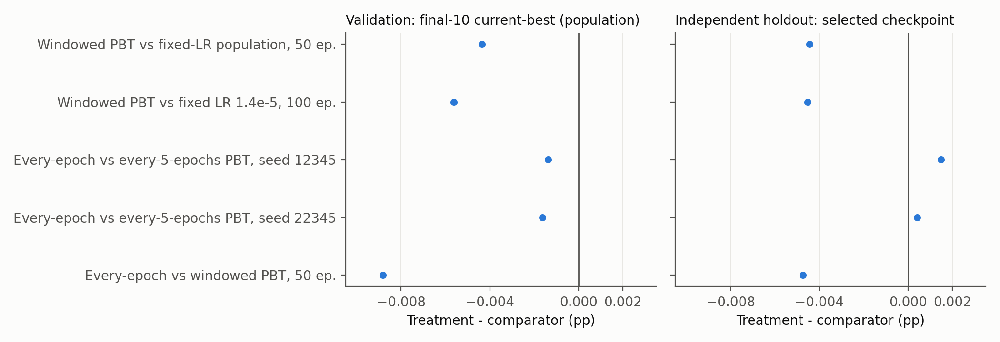
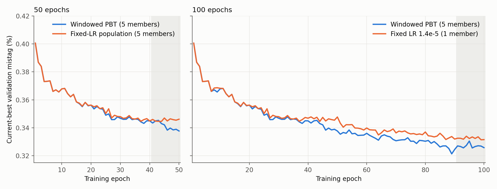
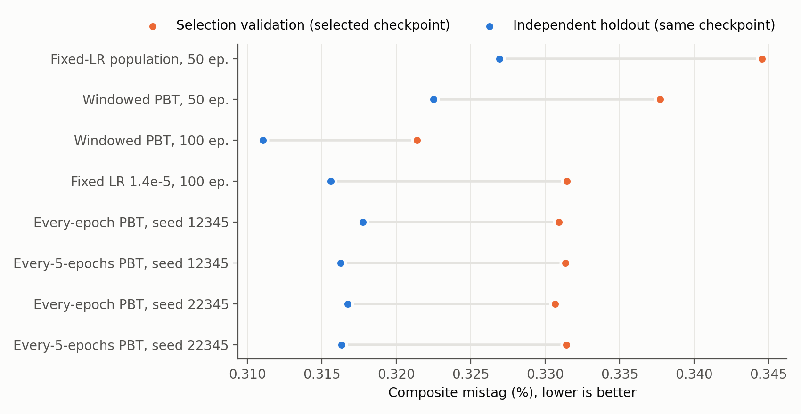
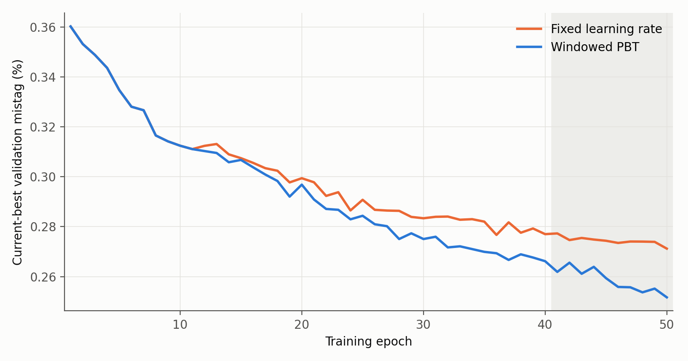
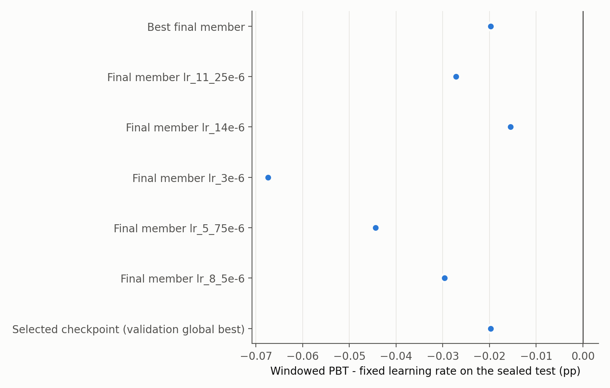

Results and Limitations
=======================

Composite mistag in percent; lower is better. Endpoints and splits are defined in
:doc:`evaluation`. All values are generated from the run manifests and the holdout
evaluation by :repo:`scripts/publish/export_results_summary.py`; tables, trajectories
and source hashes are in :repo:`published/results`.

.. _main-comparisons:

Main comparisons
----------------

Treatment − comparator; negative favours the treatment. The validation column is the
population endpoint (final-10 current-best); the holdout column is one selected
checkpoint per run (:ref:`endpoints`). The two describe different quantities.

.. list-table::
   :header-rows: 1
   :widths: 32 17 17 17 17

   * - Comparison
     - Validation final-10
     - Difference
     - Holdout, selected checkpoint
     - Difference
   * - Windowed PBT vs fixed-LR population, 50 epochs
     - 0.341219 / 0.345568
     - −0.004350 (−1.26%)
     - 0.322484 / 0.326934
     - −0.004450 (−1.36%)
   * - Windowed PBT vs fixed LR 1.4 × 10⁻⁵, 100 epochs [#asym]_
     - 0.326944 / 0.332571
     - −0.005627 (−1.69%)
     - 0.311050 / 0.315582
     - −0.004533 (−1.44%)
   * - Every-epoch vs every-five-epochs PBT, seed 12345
     - 0.332391 / 0.333758
     - −0.001366 (−0.41%)
     - 0.317738 / 0.316246
     - **+0.001492 (+0.47%)**
   * - Every-epoch vs every-five-epochs PBT, seed 22345
     - 0.332398 / 0.334040
     - −0.001642 (−0.49%)
     - 0.316731 / 0.316314
     - **+0.000418 (+0.13%)**
   * - Every-epoch vs windowed PBT, 50 epochs [#policy]_
     - 0.332391 / 0.341219
     - −0.008827 (−2.59%)
     - 0.317738 / 0.322484
     - −0.004746 (−1.47%)

.. [#asym] Asymmetric: one fixed-LR member, continued to 100 epochs after it was the best
   member at epoch 50, against a five-member population.
.. [#policy] The policies differ in several rules, not only cadence.

.. _windowed-vs-fixed:

Windowed PBT versus fixed learning rates
~~~~~~~~~~~~~~~~~~~~~~~~~~~~~~~~~~~~~~~~

Both evaluations favour windowed PBT by 1.3–1.7%.
At 50 epochs the current-best trajectories are identical through epoch 15; afterwards PBT
is lower in 28 of 35 epochs. Its selected checkpoint mistags fewer holdout background jets
at seven of eight working points and the same number at the eighth. Learning rates moved
above the initial grid, reaching the upper bound in the 100-epoch run.

   Current-best validation value per epoch; shaded: final-10 window.

.. note::

   Earlier reports gave 0.327181% and −1.62% for 100-epoch windowed PBT. That is the
   final-10 mean of the ``lr_3e-6`` member alone. The population endpoint is 0.326944%
   (−1.69%).

.. _adaptation-frequency:

Adaptation frequency: ranking reversed on the holdout
~~~~~~~~~~~~~~~~~~~~~~~~~~~~~~~~~~~~~~~~~~~~~~~~~~~~~

Every-epoch and every-five-epochs PBT are otherwise identical (:ref:`learning-rate-policies`)
and were run with two training seeds each. On validation, every-epoch PBT is better for
both seeds, by 0.0014 and 0.0016 pp in the population endpoint and by 0.0004 and
0.0008 pp in its selected checkpoint. On the holdout, the same selected checkpoints rank
the other way for both seeds: every-epoch PBT is worse by 0.0015 pp (seed 12345) and
0.0004 pp (seed 22345). In the paired counts, every-epoch PBT mistags more background jets
at seven of eight working points for seed 12345; for seed 22345 the working points are
split (four worse, three better, one equal).

The data do not identify a cause. Three properties of the design are compatible with the
reversal and are not separated by these runs:

* every-epoch PBT has five times as many decision opportunities and applied more copies
  (32 and 25 against 9 and 8), each chosen on the same validation set used for the
  endpoint and for checkpoint selection, so its validation values can be more optimistic;
* the differences are of the size by which checkpoints of similar quality reorder between
  validation and holdout (below);
* one seed pair per setting gives no estimate of seed-to-seed variation.

Adaptation frequency is therefore reported as inconclusive.

.. _independent-holdout:

Independent holdout results
---------------------------

Selected checkpoints evaluated once on the 2,825,125-jet holdout (:ref:`holdout-protocol`).
The final-10 column is the population endpoint of the same run, given for context; it is
not a property of the selected checkpoint.

.. list-table::
   :header-rows: 1
   :widths: 36 12 17 17 18

   * - Selected checkpoint
     - Training epoch
     - Validation, selected
     - Validation, final-10
     - Holdout
   * - Pretrained start
     - 0
     - 0.456705
     - —
     - 0.438151
   * - Fixed-LR population, 50 epochs
     - 44
     - 0.344561
     - 0.345568
     - 0.326934
   * - Windowed PBT, 50 epochs
     - 50
     - 0.337727
     - 0.341219
     - 0.322484
   * - Windowed PBT, 100 epochs
     - 89
     - 0.321381
     - 0.326944
     - 0.311050
   * - Fixed LR 1.4 × 10⁻⁵, 100 epochs (single member)
     - 99
     - 0.331445
     - 0.332571
     - 0.315582
   * - Every-epoch PBT, seed 12345
     - 42
     - 0.330931
     - 0.332391
     - 0.317738
   * - Every-five-epochs PBT, seed 12345
     - 47
     - 0.331369
     - 0.333758
     - 0.316246
   * - Every-epoch PBT, seed 22345
     - 44
     - 0.330665
     - 0.332398
     - 0.316731
   * - Every-five-epochs PBT, seed 22345
     - 49
     - 0.331417
     - 0.334040
     - 0.316314

.. _validation-vs-holdout:

**Validation versus holdout.** Every selected checkpoint scores 0.010–0.019 pp lower on
the holdout, a different sample. Rank correlation across the nine evaluated checkpoints
is 0.70: the best and the three weakest keep their ranks, the five in between (holdout
0.3156–0.3177%) reorder. Differences of about 0.001 pp are below what the validation set
resolves.

Per-checkpoint values, eight working points and paired counts:
:repo:`published/results/holdout_checkpoints.csv`,
:repo:`published/results/holdout_paired_counts.csv`. The evaluation protocol is frozen in
:repo:`configs/prepared/stage2a_holdout_v1/protocol.json`.

.. _large-dataset-comparison:

Large-dataset comparison
------------------------

Windowed PBT (arm B) against a matched fixed-learning-rate population (arm A), both
trained on ``train8m``, ten times the training data of the comparisons above, with a
sealed test opened once, after both arms had completed and passed the preregistered
validity checks. Values are exported from the campaign's integrity-checked final report
by :repo:`scripts/publish/export_large_dataset_results.py`; tables, paired counts and
trajectories are in :repo:`published/results/large_dataset`.

.. _large-dataset-status:

.. _large-dataset-results:

Results
~~~~~~~

All ten preregistered validity checks passed, including both determinism checks: the
gate state was reproduced by both arms, and all 70 same-lineage states before a member's
first copy were identical.

.. list-table::
   :header-rows: 1
   :widths: 40 15 15 30

   * - Quantity
     - Fixed LR (A)
     - Windowed PBT (B)
     - B − A
   * - Validation final-10 current-best (primary)
     - 0.274333
     - 0.258390
     - −0.015943 (−5.81%)
   * - Validation, selected checkpoint
     - 0.271205
     - 0.251662
     - −0.019543 (−7.21%)
   * - Validation, final-population mean
     - 0.287927
     - 0.254161
     - −0.033766 (−11.73%)
   * - **Sealed test, selected checkpoint**
     - 0.257172
     - 0.237459
     - **−0.019714 (−7.67%)**
   * - Sealed test, final-population mean
     - 0.277489
     - 0.240671
     - −0.036818 (−13.27%)
   * - Independent holdout, selected checkpoint (descriptive)
     - 0.253010
     - 0.235949
     - −0.017060 (−6.74%)

   Current-best validation value per epoch; shaded: final-10 window.

The current-best trajectories are identical through epoch 11 (the first copies follow
epoch 10); windowed PBT is lower at every later epoch. The primary difference exceeds
the 0.002 pp policy margin. Both selected checkpoints come from epoch 50: in arm A the
member with the highest learning rate of the grid (1.4 × 10⁻⁵), in arm B the member
named ``lr_3e-6``, which had been copied into twice and ended at 3 × 10⁻⁵.

On the sealed test (8,970,477 jets) every final member of arm B scores lower than its
namesake in arm A (by 0.015–0.067 pp; names are identities, and members of B were
overwritten by copies). For the selected checkpoints, arm B mistags fewer background jets
at all eight working points:

.. list-table::
   :header-rows: 1
   :widths: 40 30 30

   * - Working point
     - Mistagged by A only
     - Mistagged by B only
   * - b-tag 80%, c background
     - 448
     - 113
   * - b-tag 80%, d background
     - 142
     - 57
   * - b-tag 90%, c background
     - 9,096
     - 3,277
   * - b-tag 90%, d background
     - 430
     - 164
   * - c-tag 50%, b background
     - 1,327
     - 654
   * - c-tag 50%, d background
     - 141
     - 75
   * - c-tag 80%, b background
     - 6,084
     - 2,768
   * - c-tag 80%, d background
     - 2,467
     - 1,017

**Learning rates.** Arm B applied ten copies. Its final learning rates are 1.86–3.0 ×
10⁻⁵, all above the fixed grid (3.0–14.0 × 10⁻⁶); one member reached the upper bound
3 × 10⁻⁵. In arm A the best member is the one at the top of the grid. The comparison
therefore establishes the gain of windowed PBT over this grid; it does not separate the
benefit of adapting the learning rate during training from that of reaching learning
rates above the grid.

**Compute.** Both arms trained the same 250 member-epochs on identical accepted rows
(5,378,150,375 each) with the same number of batches; the optimizer-step counts differ
only by steps skipped for loss-scale overflow (2,331 and 2,295). Worker time was 172.6 and
180.3 GPU-hours (median 2,481 and 2,605 s per member-epoch); the arms ran at different
times on different GPU sets, and the policy adds no training or validation work.

**Scope.** One training seed; no event-level confidence interval (jets only, no event
identifier); validation values of arm B are additionally optimistic because the same
set drives its decisions; the independent holdout had been inspected in earlier
diagnostics and is reported descriptively only.

.. _large-dataset-design:

Design
~~~~~~

Preregistered before training (prose:
:repo:`configs/prepared/stage3_train8m_v1/PROTOCOL.md`; binding:
:repo:`configs/prepared/stage3_train8m_v1/protocol_v2.json`):

* training on ``train8m``, 23,921,449 jets; selection on ``val50k_tail``; sealed test
  ``test3000k``, 8,970,477 jets (:ref:`data-splits`);
* arm A fixed learning rate, arm B windowed PBT, both as in :ref:`learning-rate-policies`:
  five members each, 50 epochs (250 member-epochs per arm), identical start, seed
  schedule and accepted training rows; the policy is the only difference;
* primary endpoint: final-10 current-best, B − A; a difference below the 0.002 pp policy
  margin is reported as within selection noise;
* sealed test opened only after both arms complete and pass the validity checks; the
  evaluated checkpoints are frozen by hash beforehand;
* determinism checks: same-named members identical across arms until a member's first
  copy in arm B, and the gate's state after training epoch 1 reproduced by both arms
  (:ref:`checkpoint-identity`); a failure is reported as "determinism not confirmed" and
  qualifies, but does not invalidate, the comparison;
* every launch re-verified the hashes of the protocol, configurations, data manifests,
  starting checkpoint and 29 execution files; every resume first checked the bundle it
  resumed from against a ledger of committed checkpoint hashes.

.. _full-epoch-gate:

Full-epoch gate
~~~~~~~~~~~~~~~

One real ``train8m`` epoch of the highest-learning-rate member must pass preregistered
checks (finite losses and metrics, step and row accounting, memory, timing, clean
termination) before the arms start. Attempt 1 failed because of a verifier defect.
Weaver's maximum gradient norm is taken over all steps, including the steps skipped by
the loss scaler for overflow (7 of 21,012); after unscaling, a skipped step's gradient is
non-finite, so the logged maximum was ``inf`` and the check rejected the epoch. The
check now accepts ``inf`` only if the number of skipped steps agrees between the log, the
run manifest and the data-audit accounting and is at least one; NaN, other non-finite
values and every other criterion fail as before, and no threshold changed
(:repo:`configs/prepared/stage3_train8m_v1/gate_revision_1.json`). Attempt 2 passed, and
its epoch reproduced attempt 1 bit for bit (model, optimizer and loss-scaler files).
Measured 2,473–2,496 s per member-epoch; projected campaign cost about 460 GPU-hours.

.. _execution-record:

Execution record
~~~~~~~~~~~~~~~~

The campaign ran on shared GPUs without a batch scheduler. GPUs are leased
cooperatively, and the campaign stops its own processes (and only those) when a process
outside the campaign allocates memory on a leased GPU, so no measured epoch shared a GPU.
Three interruptions occurred during training:

.. list-table::
   :header-rows: 1
   :widths: 40 26 34

   * - Interruption
     - Committed at the time
     - Handling
   * - Campaign processes terminated by the host's memory-pressure service
     - arm A, 18 epochs
     - launcher changed to run outside that service's scope; epoch 19 recomputed
   * - Processes outside the campaign allocated memory on GPUs leased to arm A
     - arm A, 47 epochs
     - campaign stopped; epoch 48 recomputed
   * - A process outside the campaign allocated memory on a GPU selected for arm B
       during its initial evaluation
     - arm A complete; arm B none
     - campaign stopped; initial evaluation repeated

Each resumption continued from the last committed epoch after the ledger check
(:ref:`restart-semantics`); an interrupted epoch is recomputed from its starting bundle
with the same seed and data order, and completed epochs are not retrained. Matched
compute is unaffected: both arms consist of the same 250 member-epochs, and recomputed
work is not part of the per-arm figures below.

Two further stops occurred after training. The validation analysis first reported the
campaign invalid because of a verifier defect (:ref:`configuration-verification`); the
sealed test stayed closed. After the correction, five of the twelve sealed-test
evaluations stopped because more evaluations were started in parallel than GPUs were
free and the bounded wait for a GPU expired. They were rerun; the seven completed
evaluations were reused after their recorded hashes were verified, and the checkpoint
selection, frozen before the first evaluation, did not change.

.. _determinism-verification:

Correction of the determinism checks
~~~~~~~~~~~~~~~~~~~~~~~~~~~~~~~~~~~~

The two preregistered determinism checks originally compared SHA-256 hashes of the
model files. Identical states saved on different GPU indices are different files
(:ref:`checkpoint-identity`): the gate trained on one GPU, while the gate member in arm A
ran on another device index, so the gate check would have reported a mismatch for
identical states, and the lineage check would do so for members placed on different
devices in the two arms. Both checks now compare the full restart bundle in content —
model, optimizer and loss-scaler state — which also makes them stricter, since the
optimizer and loss scaler were not compared before. The correction was made after arm A
completed and before any arm-B generation, and does not depend on any PBT outcome.
Applied to the completed arm A, the gate member's bundle after training epoch 1 equals
the gate's in content although the files differ. Record:
:repo:`configs/prepared/stage3_train8m_v1/analysis_revision_1.json`.

.. _configuration-verification:

Correction of the configuration check
~~~~~~~~~~~~~~~~~~~~~~~~~~~~~~~~~~~~~

The required check that each arm's configuration equals the frozen protocol hashed the
configuration stored in the run manifest. After the initial evaluation the training
runner records the measured baseline value of the primary metric in that stored
configuration, so both arms failed the check although the fingerprints recorded at run
creation, and verified at every resume, equal the frozen ones and no other field
differed. The check now requires both the recorded fingerprint and the fingerprint of
the stored configuration, with exactly this baseline record undone (only if it equals
the initial evaluation), to equal the frozen fingerprint; any other difference fails.
The correction was made after both arms had completed and the validation analysis had
run once with this failure, but before any checkpoint selection was frozen or the sealed
test was opened; the arm endpoints computed by that run were not read. Record:
:repo:`configs/prepared/stage3_train8m_v1/analysis_revision_2.json`.

.. _supporting-studies:

Supporting studies
------------------

**Validation proxy.** Of nine frozen subsets of the selection validation set, tested on
38 checkpoints, a 60,000-jet representative subset ranks checkpoints like the full set
(Spearman 0.961) at 5.3 times lower cost, but detects whether one trajectory improved
between epochs in only 72% of cases. Summary:
:download:`qualification_summary.json <_static/proxy_validation/qualification_summary.json>`.

**Adaptive controller, shadow mode: not evaluable.** A rule-based controller read that
proxy after each of 96 generations of eight fixed-LR members and logged, without
applying, ×1.05 / ×0.95 proposals. It proposed two increases, both cancelled by a
configured bound, and no decreases. This run used the earlier contract (120,000 training
jets per generation, damped optimizer start). Audit:
:repo:`published/studies/controller-shadow-audit/report.md`.

.. _sub-epoch-restart-test:

**Sub-epoch adaptation: not testable under the current contract.** Restarting five times
within an epoch changed the result (maximum parameter difference 7.6 × 10⁻⁴ against an
uninterrupted epoch) because Lookahead state is not checkpointed
(:ref:`restart-semantics`). A full-state contract that removes this obstacle:
:ref:`sub-epoch-adaptation`.

**Training from random initialization.** Implemented and smoke-tested only; no
evaluated run.

.. _cost:

Cost
----

A 50-epoch, five-member run takes about 16 GPU-hours (median 225–233 s per member-epoch,
including about 44 s validation). PBT adds no training or validation work. Two runs had
slower medians (321 and 351 s); this is not a policy cost, since the matched every-epoch
run with the other seed took 226 s.

.. _limitations:

Limitations
-----------

* One seed per policy (two for cadence); differences of 0.001–0.002 pp changed sign
  between evaluations. The large-dataset comparison also has one seed.
* No event-level confidence intervals.
* PBT decisions, checkpoint selection and the primary endpoint share one validation set.
* The holdout was inspected in earlier diagnostics.
* The 100-epoch comparator is one selected member, not a population.
* In both 50-epoch population comparisons the comparator is a fixed grid; on ``train8m``
  its best member is the one at the top of the grid, and PBT ended above the grid.
* All results use the epoch-restarted Ranger contract.
* The common start, pretrained epoch 17, ranks only 4th of 20 pretrained epochs on the
  selection metric (:doc:`experiments/pretrained-0-19`).
* Effects of this size have not been propagated to a physics analysis.

.. _open-questions:

Open questions
--------------

How much of the large-dataset gain comes from adapting the learning rate during training,
and how much from reaching learning rates above the fixed grid (:ref:`large-dataset-results`)?
How large is seed-to-seed variation? Does adaptation frequency matter once selection
optimism is controlled? Does sub-epoch adaptation help with full optimizer state?
