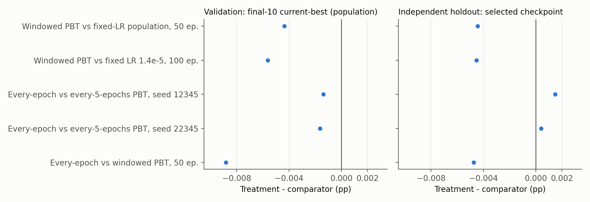
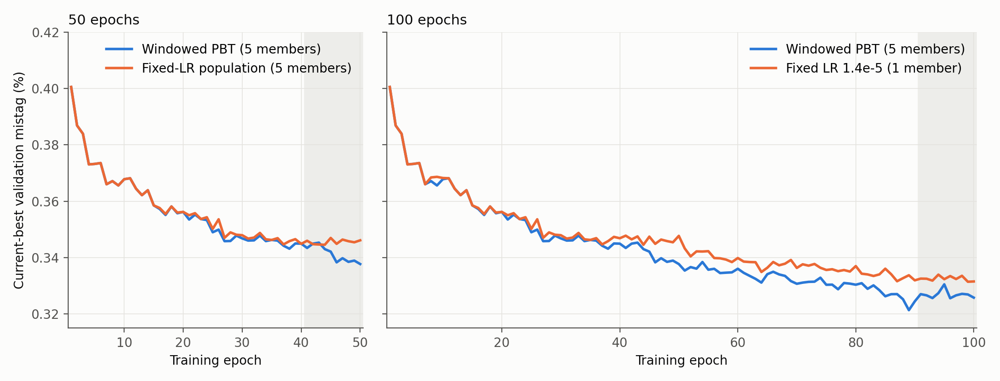
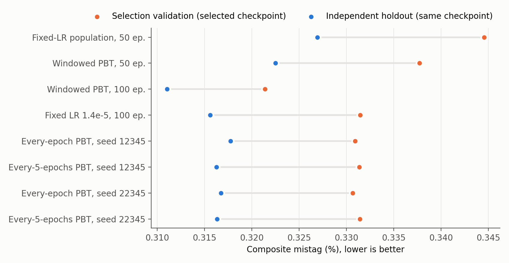

Results and Limitations
=======================

All values are composite mistag in percent (lower is better) unless stated otherwise.
Definitions of the splits and endpoints are in :doc:`evaluation`. Every number on
this page is generated from the run manifests and the holdout evaluation by
``scripts/publish/export_results_summary.py``; the tables, per-epoch trajectories and
source hashes are published in ``published/results/``
(:download:`summary.json <../published/results/summary.json>`,
:download:`validation endpoints <../published/results/validation_endpoints.csv>`,
:download:`holdout comparisons <../published/results/holdout_comparisons.csv>`).

Main comparisons
----------------

The table pairs two different quantities for each comparison: the population
validation endpoint (final-10 current-best) and the independent-holdout performance
of the checkpoint each run selected on validation. A negative difference favours
the first-named policy.

.. list-table:: Matched comparisons (treatment − comparator)
   :header-rows: 1
   :widths: 30 17 17 17 19

   * - Comparison
     - Validation final-10, treatment / comparator
     - Validation difference
     - Holdout (selected checkpoint), treatment / comparator
     - Holdout difference
   * - Windowed PBT vs fixed-LR population, 50 epochs
     - 0.341219 / 0.345568
     - −0.004350 pp (−1.26%)
     - 0.322484 / 0.326934
     - −0.004450 pp (−1.36%)
   * - Windowed PBT vs fixed LR 1.4 × 10\ :sup:`-5`, 100 epochs [#asym]_
     - 0.326944 / 0.332571
     - −0.005627 pp (−1.69%)
     - 0.311050 / 0.315582
     - −0.004533 pp (−1.44%)
   * - Every-epoch vs every-five-epochs PBT, seed 12345
     - 0.332391 / 0.333758
     - −0.001366 pp (−0.41%)
     - 0.317738 / 0.316246
     - **+0.001492 pp (+0.47%)**
   * - Every-epoch vs every-five-epochs PBT, seed 22345
     - 0.332398 / 0.334040
     - −0.001642 pp (−0.49%)
     - 0.316731 / 0.316314
     - **+0.000418 pp (+0.13%)**
   * - Every-epoch vs windowed PBT, 50 epochs [#policy]_
     - 0.332391 / 0.341219
     - −0.008827 pp (−2.59%)
     - 0.317738 / 0.322484
     - −0.004746 pp (−1.47%)

.. [#asym] Asymmetric comparison: the comparator is a single fixed-learning-rate
   member, continued from epoch 50 to 100 after it had been identified as the best
   fixed-learning-rate member, whereas windowed PBT keeps a five-member population.
.. [#policy] Not a cadence-only comparison: the two policies differ in several rules.

   Differences in percentage points for the five comparisons. Left: population
   validation endpoint. Right: independent holdout, selected checkpoints. The
   adaptation-frequency comparisons change sign between the two panels.

Windowed PBT versus fixed learning rates
~~~~~~~~~~~~~~~~~~~~~~~~~~~~~~~~~~~~~~~~

Over 50 epochs, windowed PBT and the matched fixed-learning-rate population have
identical current-best trajectories through epoch 15 (the first copies, after epoch
10, did not change the population minimum until epoch 16). Afterwards the PBT population is lower in 28 of
the remaining 35 epochs, including 8 of the final 10. Its selected checkpoint is
also 1.36% lower on the independent holdout, with fewer background jets mistagged at
seven of the eight working points and an equal count at the eighth
(:doc:`holdout_evaluation`). Windowed PBT made 6 copies in 50 epochs and 11 in 100
epochs, and its learning rates moved above the initial grid, reaching the upper bound
of 3 × 10\ :sup:`-5` in the 100-epoch run.

   Current-best validation composite mistag per training epoch. The shaded band is
   the final-10 window. At 100 epochs the comparator is a single member (see the
   footnote to the table).

The 100-epoch comparison points the same way, but its comparator is weaker by
construction than a matched population would be in one respect (one member instead
of five) and stronger in another (the member was chosen with hindsight at epoch 50).
The magnitude should not be read as a matched effect size.

.. admonition:: Correction to earlier reports of the 100-epoch result

   Earlier pages reported a final-10 value of 0.327181% for 100-epoch windowed PBT
   and a 1.62% relative reduction. That value is the final-10 mean of one member's
   lineage (``lr_3e-6``), not the population endpoint used everywhere else. With the
   population definition (current best at every epoch, then averaged over epochs
   91–100) the value is 0.326944% and the reduction is 1.69%. The per-member final-10
   means are 0.327181 (``lr_3e-6``), 0.328165 (``lr_8_5e-6``), 0.328225
   (``lr_11_25e-6``), 0.328332 (``lr_5_75e-6``) and 0.329935% (``lr_14e-6``). The
   comparator value (0.332571%) and the direction of the result are unchanged.

Adaptation frequency
~~~~~~~~~~~~~~~~~~~~

With everything else matched, adapting every epoch gave a lower validation endpoint
than adapting every five epochs for both seeds (by 0.0014 and 0.0016 pp), and a lower
current-best value in 89 of 100 paired epochs. On the independent holdout the
selected checkpoints rank the other way for both seeds (by 0.0015 and 0.0004 pp).
Every-epoch PBT also has five times as many adaptation opportunities driven by the
validation set (it made 32 and 25 copies versus 9 and 8), which can make its
validation values more optimistic. **The effect of adaptation frequency is therefore not established.**
Every-epoch PBT is lower than windowed PBT on both evaluations, but that comparison
changes several policy rules at once.

Validation and holdout agreement
--------------------------------

Every selected checkpoint has a lower composite mistag on the holdout than on the
selection validation set, by 0.010–0.019 pp. The holdout is a different sample, so
the absolute offset is not interpretable as a bias by itself. Across the nine
evaluated checkpoints, the Spearman rank correlation between validation and holdout
is 0.70. The best (100-epoch windowed PBT) and the three weakest checkpoints keep
their ranks, but the order of the five checkpoints between 0.3156% and 0.3177% on the
holdout differs from their validation order. Differences of about 0.001 pp between
selected checkpoints are not resolved by this validation set.

   Validation value of each selected checkpoint and its value on the independent
   holdout. The pretrained start (0.456705% validation, 0.438151% holdout) is omitted
   for scale.

Supporting and negative results
-------------------------------

* **Validation proxy.** A 60,000-jet representative subset ranks checkpoints almost
  like the full selection set (Spearman 0.961) at 5.3 times lower cost, but detects
  the direction of change between consecutive epochs of one trajectory in only 72%
  of cases. It qualifies as a measurement for controller studies, not as a
  replacement for validation (:doc:`proxy_validation`).
* **Adaptive learning-rate controller (shadow mode).** Over 96 epochs and eight
  fixed-learning-rate members the controller proposed only two increases, both
  cancelled by a configured bound, and no decreases. Its usefulness could not be
  assessed (:doc:`exploratory_studies`).
* **Sub-epoch adaptation.** Adapting at 0.2-epoch intervals is blocked: the
  checkpoint format does not preserve the Lookahead state, and a restarted
  five-chunk epoch diverged from an uninterrupted one (maximum parameter difference
  7.6 × 10\ :sup:`-4`) (:doc:`exploratory_studies`).

Computational cost
------------------

One member-epoch on the 2.39-million-jet training set took a median of 225–233 s
(including about 44 s of validation) in seven of the nine runs; a 50-epoch,
five-member run used about 16 GPU-hours. Two runs had median member-epoch times of
321 s and 351 s. These differences are not caused by the policies: the matched
every-epoch run with seed 22345 made 25 copies at a median of 226 s, and a copy is a
file transfer between epochs. PBT adds no training or validation work relative to
the fixed-learning-rate population, because every member is validated every epoch in
both. Per-run measurements are in ``published/results/summary.json``. The cost of the
ten-times larger study is reported in :doc:`ongoing`.

Limitations
-----------

* **Few seeds.** Each policy comparison rests on one training seed (two for
  adaptation frequency). Seed-to-seed variation is unknown, and the cadence result
  shows that differences of 0.001–0.002 pp can change sign between evaluations.
* **No event-level uncertainty.** The data contain no physical event identifier,
  so no confidence interval that respects event correlations can be computed.
  Paired per-working-point counts are reported instead (:doc:`holdout_evaluation`).
* **Repeated selection on one validation set.** PBT decisions, checkpoint selection
  and the primary endpoint all use the same 150,000-jet set. PBT's validation values
  are optimistic, more so with more frequent adaptation.
* **Previously inspected holdout.** The holdout was not used for any selection
  here, but it was examined in earlier diagnostic studies. The ongoing study
  therefore reserves a sealed test set.
* **Asymmetric 100-epoch comparator.** One selected member versus a five-member
  population.
* **Restarted optimizer.** All runs use the epoch-restarted Ranger contract
  (:doc:`method`); conclusions may not transfer to uninterrupted training or to
  other optimizers.
* **Starting checkpoint.** All runs start from pretrained epoch 17. On the
  selection validation set, pretrained epochs 16, 18 and 19 score better than
  epoch 17 (best: epoch 19, 0.447955%), so the starting point was not chosen on
  this metric (:doc:`experiments/pretrained-0-19`).
* **Small effects.** The observed improvements are about 1–2% relative. Their
  physics significance for an analysis using the tagger has not been studied.

Open questions
--------------

1. Does the windowed-PBT advantage hold on a ten-times larger training set and on a
   sealed test set? (:doc:`ongoing`)
2. How large is the seed-to-seed spread of each policy's endpoints?
3. Does adaptation frequency matter once selection optimism is controlled?
4. Can an adaptive controller be made active often enough to be evaluated?
5. Does adaptation within an epoch help once the full optimizer state is preserved
   across restarts?

.. toctree::
   :hidden:

   holdout_evaluation
   proxy_validation
   exploratory_studies
